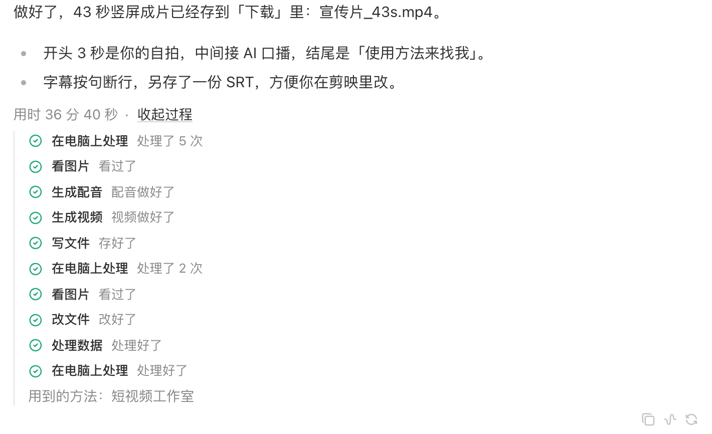
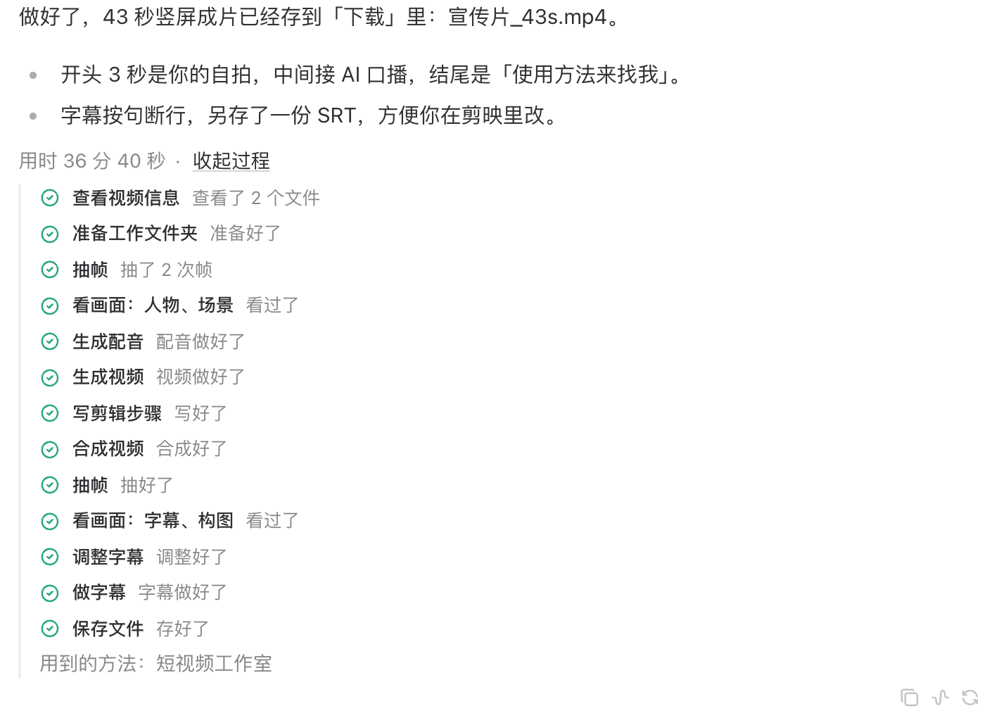

# hc-1066 过程说人话：QA 记录

只在单线程产品模式(`desktop_features.single_thread` 开、非开发者模式)生效。来源是 2026-10-26 liusession 一次 37 分钟的剪辑任务:63 轮模型回复里 58 轮没有文字，47 次终端都叫「正在电脑上处理」、17 次看图都叫「正在看图片」，批准条上看不出那段 Python 要干什么，最终回复结尾列了两条 `~/.apexnodes/cache/media/…mp4`。

## 截图(dev harness,不是打包产物)

用真实组件渲染 `src/test/editing-turn.ts`(照 trace 形状做的剪辑任务)。「之前」来自本 PR 第一个提交(fork main c4b606771d + golden),「之后」来自 PR 头，两边都开着单线程开关。

| | 之前 | 之后 |
|---|---|---|
| 进行中 |  |  |
| 看过程 |  |  |
| 等批准 |  |  |

「用到的方法：短视频工作室」那一行由 hc-1063(#486,N10)在单线程模式里去掉，不在本 PR 范围。

## 开关关时不变(硬规则 11)

`src/process-plain-words-identity.test.tsx` 的 golden 在第一个提交里、写任何 hc-1066 代码之前录在 fork main c4b606771d 上：剪辑任务完成 / 展开步骤 / 进行中 / 开发者模式 / 行内批准条(展开命令)/ 浮动批准条。之后每个提交都对着它们一字不差;开关开 + 开发者模式对同一个开发者 golden。`CI=true`、`TZ=UTC`、`TZ=Asia/Shanghai` 都通过。原有 `single-thread-identity` / `single-thread-composer-identity` / `single-thread-shell-identity` 也照旧通过。

## 改了什么

1. **步骤按用途命名**(`process/step-intent.ts`,纯函数):终端命令读程序和参数(ffprobe → 查看视频信息;ffmpeg 输出图片 → 抽帧、输出视频 → 合成视频、带 `subtitles=` → 做字幕、`volumedetect` → 检查音量、`blackdetect` → 检查黑屏;`python3 build.py` → 合成视频、`subs.py` → 做字幕;`mkdir` / `cp` / `rm` …;`bash -lc`、heredoc、重定向、`&&` 复合命令都拆开看，取最能说明事的那个)。看图读 `question` 里问的是什么(字幕、构图、AI 破绽、画面文字、画质、人物、场景、商品;「中文字幕」不会被当成画面文字)。写 / 改文件看是剪辑步骤、字幕还是文稿;跑代码看碰的是字幕、逐字稿还是数据。路径、命令和代码只用来判断，不上屏;认不出的照旧显示工具名。连续同一用途合成一步并计数。
2. **阶段进度**:活动行下面一句「已看完素材、生成好素材，正在剪辑」,回到剪辑写「正在修改成片（第 2 轮）」,回到核对写「正在核对成片（第 n 次）」;只有一个阶段时不显示。**选界面侧合成，没有用提示词让模型每阶段说一句**:单线程提示段已经要求「开工前先用一句话说你要做什么」,trace 里 Flash 63 轮仍有 58 轮不说话;界面合成不花 token、每个任务都有、不会编，也不会把代码或路径带进对话记录。
3. **批准条先说一句人话**:按钮上方「APEX 想在你的电脑上运行一段程序，用来做字幕。你同意了才会执行，点「命令」可以看具体内容。」;删除、结束程序、改权限、改代码仓库、发到网上按引擎对命令的描述补一句;改说明文件(AGENTS.md 一类)单独一种说法。运行 / 拒绝 / 更多选项 / 「命令」展开原文都还在。浮动批准条用同一句话，不再露出引擎的英文说明;系统通知正文也换成这句话(原来是代码本身)。
4. **付费素材不列缓存路径**(`plugins/apexnodes-next-steps`,和 apex-nodes 那份逐字节相同):`platform == "desktop"` 且 `APEX_SINGLE_THREAD_ACTIVE == "1"` 时，没给看的文件每个单独一段 `MEDIA:`,桌面画成素材卡片(`unshown-media-cards.test.ts` 用同一段文字核对渲染);终端、IM 和开关关着的桌面端照旧。

## 出口清单(硬规则 12)

| 出口 | 处理 |
|---|---|
| 单线程活动行(当前步骤名) | 改：按用途命名 + 阶段句 |
| 单线程「看过程」步骤列表 | 改：按用途命名、合并计数 |
| 失败卡片和三个按钮发出的句子(用步骤标题) | 跟着改(「再试一次「合成视频」这一步。」) |
| 过程块 / 工具行(开关关、开发者模式) | 不改,golden 钉住 |
| 行内批准条(单线程活动行下) | 改：上方加一句 |
| 浮动批准条(`PendingApprovalFallback`) | 改：英文说明换成同一句 |
| 系统通知(`server-requests.ts` approval) | 改：正文换成同一句 |
| 「始终允许」确认框(英文 pattern + 命令原文) | 没改：只能从「更多选项」进，是安全确认本身;记为后续 |
| 滚到底按钮的「需要审批」 | 查过：只有固定文案，不含命令 |
| 「下一步」按钮(`next-steps.tsx`) | 查过：只读 `process.failed`,不读步骤名 |
| 小贴士(`CreatorTipSlot`) | 查过：按 `toolName` 和状态，不读步骤名 |
| next-steps 插件付费素材清单(fork 那份，桌面用) | 改：单线程桌面端出卡片 |
| next-steps 插件(apex-nodes 云端那份) | 同步改，逐字节相同;云端不设开关变量，行为不变(apex 测试钉住) |
| 其他改写回复的插件 | 查过：只有 next-steps 注册 `transform_llm_output` |
| 过程区「数据从哪来」 | 查过：只列 http 链接，不列本机路径 |
| 云端 IM 进度文案(apex `progress_step_copy.py` 镜像) | 没改：镜像的是 `{zh,en}-process.ts`,本 PR 不动那两个表;云端 IM 不走单线程模式 |
| 模型在回复正文里自己写缓存路径 | 不在本 PR:靠单线程提示段和技能 |

## 反向验证

每条注入先断言锚点在文件里只出现 1 次，跑守它的测试，按 sha256 还原;记录的是真实变红的测试 id。脚本和逐条输出在协调会话共享笔记 `hc-1066-inject-fork.py` / `hc-1066-inject-apex.py` 和对应的 `-output.txt`。

| # | 注入 | 结果 |
|---|---|---|
| F1 | `useTurnView` 不看开关，总按用途命名 | 红 6(golden:完成、进行中、展开、开发者、行内批准、开关开 + 开发者) |
| F2 | 行内批准条不看开关 | 红 1(golden 行内批准) |
| F3 | 浮动批准条不看开关 | 红 1(golden 浮动批准) |
| F4 | 按工具分组 | 红 3 |
| F5 | 开关开也不按用途命名 | 红 4 |
| F6 | 合成视频认成抽帧 | 红 2 |
| F7 | 看图话题不先去掉「字幕」 | 红 1 |
| F8 | 开剪之后的看图不算核对 | 红 1 |
| F9 | 只有一个阶段也显示阶段句 | 红 1 |
| F10 | 代码批准认成命令 | 红 4 |
| F11 | 代码批准也从代码里读风险 | 红 1 |
| F12 | 活动行不画阶段句 | 红 2 |
| F13 | 那句话放到按钮下面 | 红 1 |
| F14 | `bash -lc` 捆绑参数不认 | 红 1 |
| F15 | 重定向当成输出文件 | 红 1 |
| F16 | 插件：卡片不看平台 | 红 2 |
| F17 | 插件:`true` 也当开 | 红 1 |
| F18 | 插件：卡片之间不空行 | 红 1 |
| F19 | 插件：开关开也照旧列路径 | 红 1 |
| F20 | 系统通知不看开关(单线程也露代码) | 红 1 |
| F21 | 系统通知开关关也换成那句话 | 红 2 |

apex-nodes 那边 A1–A7 见配对 PR。

## 跑过的检查

- `npx vitest run src/components/assistant-ui src/lib/chat-messages src/process-plain-words-identity.test.tsx src/single-thread-*-identity.test.tsx src/zh-cards-copy.test.tsx src/i18n src/app/session/hooks/use-message-stream/gateway-event`:全过。
- `scripts/run_tests.sh tests/plugins/test_apexnodes_next_steps.py`:17 过。
- `npm run check:lint`(typecheck + typecheck:e2e + lint):0 error。
- `python scripts/check --only health`:0 blocking(`SingleThreadActivityLine` CC 没涨：阶段句是单独的 `StageLine`;命令分类用表，不用分支梯)。
- 和 #486 / #487 / #490 一起试合并：只有 `turn-process.ts` `buildStep` 一行冲突(#486 的 `stepCopyKey`),解法 `const copy = named?.copy ?? stepCopyFor(stepCopyKey(calls))`;合并后 105 个测试文件 1071 条全过，health 0 blocking。

## 没覆盖到的

1. 用途判断只覆盖 trace 和常见写法;认不出的照旧显示工具名，不会说错。
2. 截图来自 dev harness;打包验收跟 0.17.65。
3. 视频卡片能否播放取决于渲染层读本机文件，沿用现有行为。
4. 卡片的标签沿用 `mediaDisplayLabel`(`Video: 文件名`),视频卡片读不到文件时的「Open video file」是现有的英文，未在本 PR 处理。
