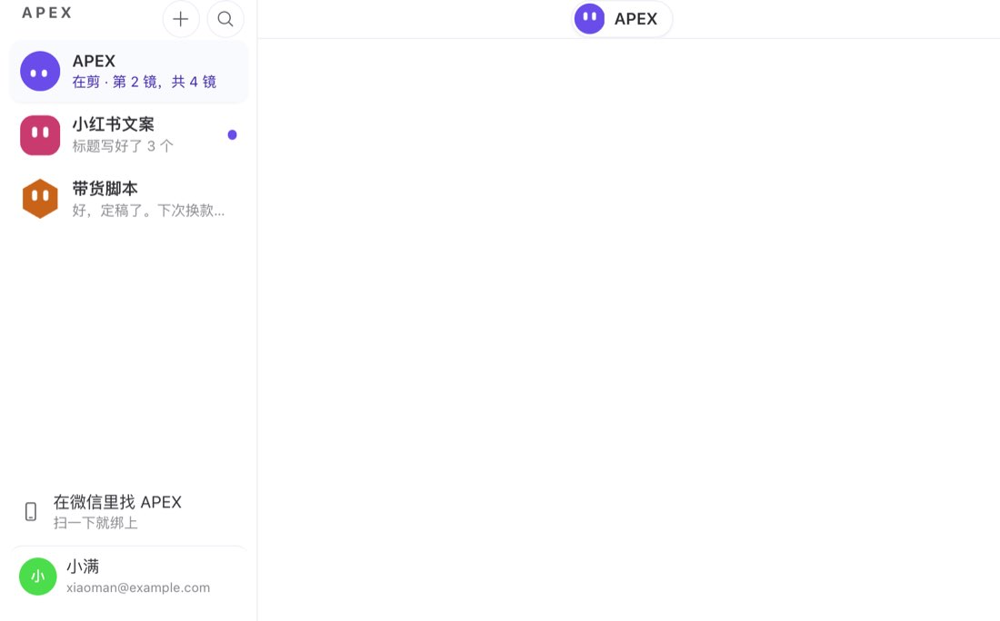
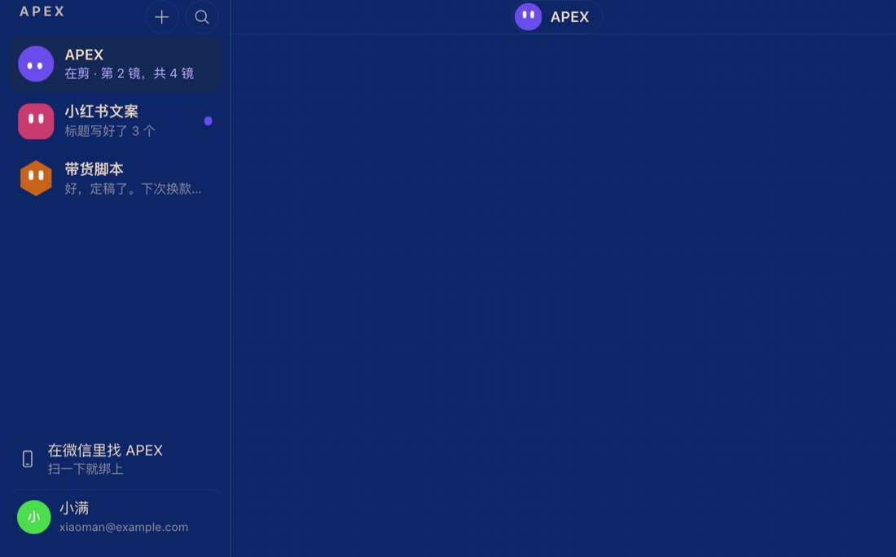
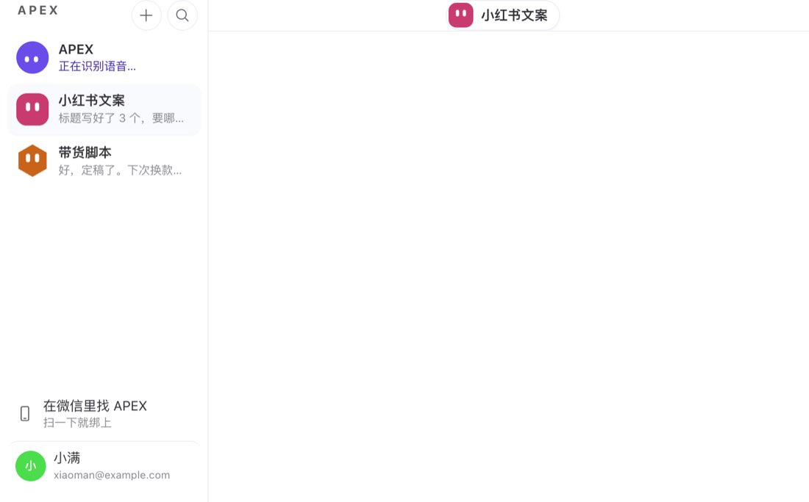
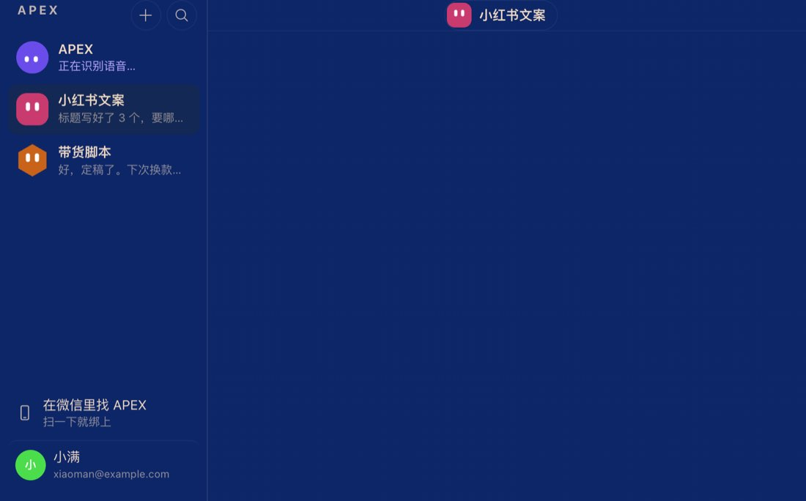

# hc-1077 — 多助手第一期 M1:单线产品模式的侧栏支持多个助手和切换

## 范围

- 只在单线产品模式(`desktop_features.single_thread` 开、不是开发者模式)且 `desktop_features.multi_bot` 开(或本机 `APEXNODES_MULTI_BOT=1`)时生效，默认关。开关关、开发者模式：一字节不变(golden 在第一笔、在干净 fork main `50a50d1bf7` 上录)。
- 一个助手 = 一个 Hermes profile。APEX 是默认 profile;别的助手是命名 profile,各有自己的「APEX 主线」(标题是身份键，不随名字变)。
- 不在本票：新建、改名、换样子、删除(hc-1078,M2,叠在本分支上);新助手首启三问(hc-1079,M3);配置和技能覆盖到每个 profile(hc-1080、hc-1081);引擎里的名字和改名工具(hc-1082 读 `APEX_MULTI_BOT_ACTIVE`)。

## 做了什么

| 项 | 文件 | 说明 |
|---|---|---|
| 开关(主进程) | `electron/apex-desktop-features.ts`、新 `electron/apex-multi-bot.ts`、`electron/apex-model-tiers.ts` | 开关表加 `multi_bot: 'APEXNODES_MULTI_BOT'`(只读不写，照 hc-1014);同一次启动单线也开才算开;`app.whenReady` 之前写 `APEX_MULTI_BOT_ACTIVE=1`,关时删掉。主引擎和池里的引擎都展开 `process.env` 启动(测试钉住两处) |
| 开关(渲染层)、上限 | 新 `src/store/single-thread-bots.ts` | `$multiBotMode` = 单线产品模式 && 开关;上限读 `desktop_features.multi_bot_max`,整数且 ≥1,否则 5(K2) |
| 名册 | 同上 | `profiles.list` 里有 SOUL.md(用 `profiles.describe` 查，确认有就记住，没有的一分钟后再问)、没被 Bot 模式隐藏(`ui_meta['hermes-bots'].hidden`)的 profile;APEX 固定第一行，其余按 `ui_meta.apex.created`(没有就看 Bot 模式的 `created`,都没有按目录名)。名字和样子读 `ui_meta.apex` 的 `name` / `shape` / `color`(颜色存 id),未知值退回默认样子(圆角方 + 蓝)。APEX 只认名字，样子固定紫色圆。名册缓存到本机，下次启动先画 |
| 侧栏 | `src/app/single-thread/sidebar.tsx`、新 `sidebar-bots.tsx`、新 `sidebar-status.ts`、新 `bot-activity.ts` | 每行：形象 + 名字 + 状态副标题 + 未读点；顶部「+」在搜索左边(发 `$botCreateRequest`,M2 接)。当前助手读活动行和通话;后台助手从它自己的会话状态折出活动行同一句话(「正在识别语音…」),等你决定照旧;从没在本窗口打开过的，用 `profiles.list` 的最后一句，前提是那条最新会话就是它的主线。未读按 profile 记 |
| 切换 | `store/single-thread-bots.ts` `openBot` | `ensureGatewayProfile`(内部就是 `ensureGatewayForProfile`)激活那个 profile 的引擎;不调 `profile.remember`,所以启动 profile、本机 IM 网关和 IM 绑定一直是 APEX(K7)。点下去立刻记下要去的助手(`$botIntent`),侧栏、头部、空对话、`/` 的重定向、发送都先跟着它，不会先跳进上一个助手的主线 |
| 主线和状态按 profile | `src/store/main-thread.ts`、`src/store/single-thread-presence.ts`、新 `src/app/single-thread/use-multi-bot-shell.ts`、`use-single-thread-shell.ts`、`thread-empty.tsx`、`composer-middleware.ts` | `$mainThread` 仍是当前 profile 的;新 `$mainThreadsByProfile` 记每个 profile 的,后台查找(`resolveProfileThread`)和压缩轮换都跟着，找到的不会被一次失败降级。外壳每 20 秒和每次切换读一次名册和别的助手的主线。别的入口(系统通知、搜索)打开另一个助手的主线时，那个助手自动到前台;每次选中只试一次，切不过去不会死循环 |
| 名字跟着当前助手 | `thread-header.tsx`、`use-composer-placeholder.ts`、`single-thread-stop.tsx`、`single-thread-process.tsx`、`plain-steps.ts`、`server-requests.ts`、`memory-noted-line.tsx`、`first-open.tsx`、新 `bot-names.ts`(`/model`)、`chat-swap-overlay.tsx` | 头部胶囊(名字和形象)、「给 X 发消息」、「让 X 停下手上的事」、活动行(标签和形象)、批准句子、「X 记下了」、问候、`/model` 提示、「正在唤醒 X」。批准的系统通知按发请求的引擎的 profile 起名，所以后台助手要批准时通知里写的是它 |
| 只在 APEX | `sidebar-wechat.tsx`、`first-open-ideas.tsx` | 「在微信里找」按 APEX 现在的名字(APEX 能改名),不跟当前助手;今日点子只在 APEX 的空对话(K7) |
| 形象 | `src/components/apex-avatar.tsx`、新 `apex-avatar-look.ts` | 加 `shape`、`color` 两个参数，默认值不变(APEX 仍画 `<circle>`)。取值表导出：6 种形状 `circle / squircle / pill / hexagon / cloud / drop`,6 种颜色 `blue #2563D9 / teal #0B8A7B / green #2E8A40 / orange #C9631A / rose #C93A6E / gold #9A6B00`,不含 APEX 紫;和白眼对比 5.43 / 4.25 / 4.35 / 3.97 / 4.87 / 4.69(都 ≥3:1);深色模式颜色不变，所以深色侧栏上一样 |
| 行状态 | 新 `src/app/single-thread/bot-status.ts` | 每行的副标题、忙不忙、未读点都在 `useBotRowStatus` 里决定;名册每行带 profile 的整份 `ui_meta`(`uiMeta`),hc-1079 的三问状态接在这里 |
| 档位跟账户走(K3) | `src/app/settings/model-tier-settings.tsx`、`store/single-thread-bots.ts` `useAccountModelScope` | 单线产品模式里能选档位 / 模型的只有 设置 › 模型(tier 模式叫 档位)。多助手开、屏幕上不是 APEX 时，这一页读写 APEX(default,根)那一份;其余助手靠 hc-1080 的「跟 APEX 的档位走」跟上。输入框的模型和推理档位、模型选择器和快捷键、`/model`、`/moa`、生成行的模型选择、错误卡的「切换提供方」在 APEX 账号的单线产品模式里本来就不显示(`$modelChoiceHidden`,hc-1015),查过不用改 |
| 打不开时说人话 | `sidebar-bots.tsx`、新 `shared/apex-pool-busy.ts` | 只说「暂时打不开「X」，稍后再试。」并带「重试」，引擎报错原文只进 console。池里的引擎全在做事时(hc-1080 的 `APEX_POOL_ALL_BUSY`),说「小红书文案、APEX 都在做事，等其中一个做完再切过来。」。`shared/apex-pool-busy.ts` 和 fork #500 的同名文件逐字节相同。冷启动时对话区的「正在唤醒 …」浮层写助手名字 |

## 截图

开发用渲染页(真实组件 + 假的桥，不是打包产物),宽 232px 的侧栏 + 头部胶囊:

| 画板 | 浅色 | 深色 |
|---|---|---|
| ⑥ 在 APEX 上：APEX 在剪，小红书文案后台回了一句(未读点),带货脚本显示最后一句 |  |  |
| ⑨ 切到小红书文案：APEX 后台在识别语音 |  |  |

打包产物上全新环境走一遍(建满、切换、后台剪片时切走再切回、冷启动秒数)是 M7(hc-1083)的。

## 出口清单(硬规则 12)

### 写着「APEX」、说的是正在聊的助手

| 出口 | 文件 | 处理 |
|---|---|---|
| 头部胶囊的名字和形象 | `app/single-thread/thread-header.tsx` | 改：当前助手 |
| 侧栏助手行的名字 | `app/single-thread/sidebar.tsx` `AssistantRow` | 开关关原样；多助手时换成 `sidebar-bots.tsx` 每行自己的名字 |
| 输入框占位和无障碍名「给 APEX 发消息」 | `app/chat/composer/hooks/use-composer-placeholder.ts` | 改 |
| 活动行「停」的无障碍名「让 APEX 停下手上的事」 | `components/assistant-ui/process/single-thread-stop.tsx` | 改 |
| 活动行无障碍名「APEX 在做的事」和低头的形象 | `components/assistant-ui/process/single-thread-process.tsx` | 改(名字和形象) |
| 批准句子「APEX 想在你的电脑上运行…」(行内、浮条) | `components/assistant-ui/process/plain-steps.ts` | 改：当前助手 |
| 批准的系统通知正文 | `plain-steps.ts` `approvalNotificationBody` + `server-requests.ts` | 改：按发请求的引擎的 profile 起名(后台助手的批准写它自己的名字) |
| 「APEX 记下了：…」 | `components/assistant-ui/thread/memory-noted-line.tsx` | 改(底账仍是一份，K1) |
| 空对话问候「你好，我是 APEX…」和首启「APEX 记下了」 | `app/single-thread/first-open.tsx` | 改。新助手的首启三问是 hc-1079 |
| `/model` 的提示「APEX 会按要做的事自己安排」 | `app/session/hooks/use-prompt-actions/slash.ts` → 新 `app/single-thread/bot-names.ts` | 改(slash.ts 只换了一行 import 和同一行调用) |
| 切换时的「正在唤醒 …」 | `app/chat/chat-swap-overlay.tsx` | 改：多助手时写助手名字，不再露出 profile 目录名 |
| 「在微信里找 APEX」 | `app/single-thread/sidebar-wechat.tsx` | 按 APEX 现在的名字，不跟当前助手(K7:微信只接 APEX) |

### 查过、不用改

| 出口 | 为什么 |
|---|---|
| 侧栏顶部的「APEX」字标 | 品牌字标，不是助手名字(原型 ⑥ 也不变) |
| `single-thread-chat` 的 greetingHint、更早的对话、只读条、分段提示 | 不提名字 |
| `single-thread-first-open` 的三问、收尾贴士 | 不提名字(问候句由上面那一处组出来) |
| 过程步骤文案(`single-thread-process.ts` 除批准外) | 不提名字 |
| `zh.ts` 等主目录里的「APEX 会…」(设置说明、更新、通知设置的说明文字) | 说的是 App,不是正在聊的助手 |
| 系统通知标题「回复就绪」「需要输入」 | 不提名字(见后续 1) |
| 快速输入小窗的「问 APEX 点什么…」 | 小窗是另一个渲染进程，读不到主窗口当前助手；捕获会进屏幕上那个助手的主线。第一期不改，见后续 2 |
| 引擎提示段「你叫 APEX」 | hc-1082(M6),读本票写的 `APEX_MULTI_BOT_ACTIVE` |
| 开发者模式的 Bot 模式插件(`plugins/hermes-bots/*`) | 一个文件没动 |

### 按单例取主线或状态的地方

| 出口 | 处理 |
|---|---|
| `$mainThread`(`store/main-thread.ts`) | 仍是当前 profile 的；新 `$mainThreadsByProfile` 记每个 profile 的，`resolveProfileThread` 查后台助手，压缩轮换也跟。找到的不会被一次失败降级 |
| `$threadPresence` / `$threadUnread` / `$threadSeenReplyId` | 开关关原样；多助手每行用 `profileThread` + `mainThreadState` + `latestReply` + `presenceOf` 读自己的，未读按 profile 记(`$botSeenReplyIds`) |
| `$threadActivity` / `$threadInCall`(`store/thread-signals.ts`) | 属于屏幕上那条对话，只给当前助手那一行用；后台助手从自己的会话状态折(`bot-activity.ts`)。文件没动 |
| 外壳查主线、`/` 重定向(`use-single-thread-shell.ts`) | 查找照旧按当前 profile;切换没落地时不重定向 |
| 空对话(`thread-empty.tsx`) | 切换没落地时不显示上一个助手的空对话 |
| 发送(`composer-middleware.ts`) | 切换没落地时不发，消息留在输入框(「正在打开对话，稍等一下再发。」) |
| 头部判断(`useSingleThreadHeader`)、历史页「更早的对话」、`isMainThreadStoredId` | 用当前 profile 的主线和会话列表，就是当前助手的，不用改 |
| 分段起点 `$segmentStarts` | 按主线根 id 记，本来就分得开，不用改 |
| `$pendingThreadClaim` | 自带 profile,不用改 |
| 快速输入的落点(`app/single-thread/quick-entry.ts`) | 进当前 profile 的主线，就是屏幕上的助手；切换途中按的那一下会进上一个助手(见后续 2) |
| 系统通知点开、命令面板打开别的助手的主线(`use-desktop-integrations.ts` `onFocusSession`) | 外壳看到选中的是别的助手的主线，就把那个助手切到前台；每次选中只试一次 |
| 今日点子(`first-open-ideas.tsx`) | 只在 APEX(K7) |
| IM 绑定、本机消息网关(主进程按 `active-profile.json`,`readActiveDesktopProfile()`;启动、重载、重新绑定时对齐) | `openBot` 只走 `ensureGatewayProfile`(内部 `ensureGatewayForProfile`),不调 `selectProfile` / `switchProfile` / `profile.remember` / `profile.set`,所以 `active-profile.json` 不变，微信一直接 APEX(K7)。守卫：`single-thread-bots.test.ts` 钉住源码里没有这些调用;反向注入 R12(加一句 remember)、R47(换成 selectProfile)都变红。见后续 3 |
| 设置 › 模型 / 档位(按 `$settingsScopeProfile`,默认跟当前 profile) | 多助手开、不在 APEX 时改成 APEX 那一份(K3,见上) |
| 开发者模式、上游 Bot 模式建的助手的档位 | 主进程读不到开发者模式，`APEX_MULTI_BOT_ACTIVE` 只看单线和 multi_bot;hc-1080 按 profile 来源区分：带 `ui_meta.apex` 的(产品模式建的)才跟 APEX 的档位，没有的保留自己的档位，hc-960 按 bot 选档位对它们不变。池满挤空闲引擎在多助手开着时照常生效 |
| 设置里别的页(工作区、安全、语音、工具和密钥等) | 仍跟当前 profile;第一期不做每个助手自己的设置(方案第 4 节),见后续 7 |
| 记忆底账 | 一份共用(K1),不用改 |
| 引擎环境变量 | 主引擎和池引擎都展开 `process.env`,测试钉住 |

## golden 和身份守卫(硬规则 11)

- 第一笔 `09bf2ecddb` 只有录制工具 `src/__identity__/multi-bot/render.tsx`、测试和 golden,在干净 fork main `50a50d1bf7` 上录：单线开时产品模式(`product-*`)和开发者模式(`developer-*`)的侧栏(有未读、在做事)、输入框、进行中的回合、批准(行内和浮条)、「记下了」、头部胶囊、空对话，共 16 份。录两次 `diff -r` 一致，`CI=true`、`TZ=UTC`、`TZ=Asia/Shanghai` 重跑都通过。
- 之后每一笔都要它们一字节不变：`multi_bot` 关(产品模式和开发者模式)、`multi_bot` 开但开发者模式，都对同一套 golden;`multi_bot` 开但单线关，侧栏对 hc-1014 的 `single-thread-shell/sidebar.html`。
- 新录(`multi-bot-*`,本票才有):画板 ⑥(在 APEX 上、APEX 在剪、小红书文案后台回了一句有未读、带货脚本显示最后一句)、画板 ⑨(在小红书文案上、APEX 后台在识别语音)、另一个助手的头部胶囊。
- 身份守卫(K6):不管 `profiles.list` 把默认 profile 排在哪、它的 `ui_meta.apex` 写了什么样子、甚至列表里没有它，侧栏第一行都是 APEX,形象是原样的 `<circle cx="14" cy="14" fill="#6A4CEB" r="14">`,`canDeleteBot` / `canRestyleBot` 都是 false(`src/multi-bot-identity.test.tsx`)。
- `src/apex-avatar-identity.test.tsx` 的形象白名单加了 `app/single-thread/sidebar-bots.tsx`(只在多助手产品模式由 `sidebar.tsx` 挂)。

## 测试

- 新：`electron/apex-multi-bot.test.ts`、`src/store/single-thread-bots.test.ts`、`src/components/apex-avatar.test.tsx`(含按 WCAG 算的对比度)、`src/app/single-thread/bot-activity.test.ts`、`sidebar-bots.test.tsx`、`use-multi-bot-shell.test.tsx`、`src/multi-bot-names.test.tsx`、`src/multi-bot-identity.test.tsx`。
- 加了用例：`main-thread.test.ts`(按 profile)、`composer-middleware.test.ts`(切换中不发)、`first-open.test.tsx`(点子只在 APEX、记下了用当前名字)、`approval-notification.test.ts`(按发请求的 profile 起名)、`model-tier-guard.test.tsx`(K3:不在 APEX 时档位页读写 default)。
- 整个 Desktop 测试(`CI=true npx vitest run`):1305 个文件、14349 条通过，0 失败;`npm run check:lint`(typecheck、typecheck:e2e、eslint)0 错误，本票改动的文件 0 警告;`scripts/check --only health` 0 blocking。
- `electron/packaged-runtime.test.ts` 有一次在整套并行跑时 5 秒超时，单独重跑在本分支和干净 main 上各两次都通过，和本票无关(负载下的超时)。

## 反向验证(硬规则 14)

52 个注入，每个先断言锚点只命中一次、改动确实落地，跑完按 sha256 还原。脚本和输出在协调会话笔记 `hc-1077-inject.py`、`hc-1077-inject-output*.txt`。第一轮 46 个(基线 221 条，还原后 221 条通过),第二、三轮是改动和新增的(基线 256 条，还原后 256 条通过)。

第一轮有 2 个没变红，都补上了:
- R14(开关关时，React 外面的读法碰了 computed store):守它的是 `src/app/chat/chat-swap-overlay.test.tsx`(不许留下计时器),第一轮的文件清单里没有它;加进来后变红。
- R20(屏幕上那一行也出未读点):行在同一次提交里就把回复标成已读，跑完 effect 后看不出来。加了一条用服务端渲染看第一帧(还没跑 effect)的测试，变红。

| # | 注入的故障 | 结果 | 变红的测试(文件) |
|---|---|---|---|
| R1 | engine signal without single-thread | RED 3 | apex-multi-bot.test.ts |
| R2 | launch switches forget multi_bot | RED 1 | apex-multi-bot.test.ts |
| R3 | no install switch | RED 5 | apex-multi-bot.test.ts |
| R4 | several assistants in developer mode too | RED 1 | single-thread-bots.test.ts |
| R5 | roster lists profiles without a SOUL.md | RED 1 | single-thread-bots.test.ts |
| R6 | roster lists hidden profiles | RED 1 | single-thread-bots.test.ts |
| R7 | roster ordered by name, not creation | RED 5 | multi-bot-identity.test.tsx, sidebar-bots.test.tsx, single-thread-bots.test.ts |
| R8 | APEX takes the look in its profile.yaml | RED 2 | multi-bot-identity.test.tsx, single-thread-bots.test.ts |
| R9 | name replaces only the first APEX | RED 1 | single-thread-bots.test.ts |
| R10 | no intent: the row waits for the engine | RED 2 | sidebar-bots.test.tsx, single-thread-bots.test.ts |
| R11 | re-switching to the assistant on screen | RED 1 | single-thread-bots.test.ts |
| R12 | switch remembers the startup profile | RED 1 | single-thread-bots.test.ts |
| R13 | a missing SOUL.md is never asked again | RED 1 | single-thread-bots.test.ts |
| R14 | non-React readers touch the computed store with the switch off | RED 1 | chat-swap-overlay.test.tsx |
| R15 | a background thread is downgraded by a failed read | RED 1 | main-thread.test.ts |
| R16 | a background rotation is not followed | RED 1 | main-thread.test.ts |
| R17 | a dot before the user ever looked | RED 3 | bot-activity.test.ts, multi-bot-identity.test.tsx, sidebar-bots.test.tsx |
| R18 | a background row reads the activity line on screen | RED 3 | multi-bot-identity.test.tsx, sidebar-bots.test.tsx |
| R19 | any newest conversation passes as the thread’s last line | RED 1 | sidebar-bots.test.tsx |
| R20 | the on-screen row shows its own dot | RED 1 | sidebar-bots.test.tsx |
| R21 | rows wear APEX’s face | RED 3 | multi-bot-identity.test.tsx, sidebar-bots.test.tsx |
| R22 | the several-assistants rows with the switch off | RED 2 | multi-bot-identity.test.tsx |
| R23 | 「+」 with the switch off | RED 2 | multi-bot-identity.test.tsx |
| R24 | WeChat row names the assistant on screen | RED 2 | multi-bot-identity.test.tsx, sidebar-bots.test.tsx |
| R25 | header pill keeps APEX | RED 1 | multi-bot-identity.test.tsx |
| R26 | header pill keeps APEX’s face | RED 1 | multi-bot-identity.test.tsx |
| R27 | composer keeps 「给 APEX 发消息」 | RED 2 | multi-bot-names.test.tsx |
| R28 | stop keeps 「让 APEX 停下」 | RED 1 | multi-bot-names.test.tsx |
| R29 | activity line keeps APEX | RED 1 | multi-bot-names.test.tsx |
| R30 | approval sentence keeps APEX | RED 5 | approval-notification.test.ts, multi-bot-names.test.tsx |
| R31 | notification names the assistant on screen, not the one that asked | RED 1 | approval-notification.test.ts |
| R32 | 「记下了」 keeps APEX | RED 1 | multi-bot-names.test.tsx |
| R33 | greeting keeps APEX | RED 1 | multi-bot-names.test.tsx |
| R34 | intake noted keeps APEX | RED 1 | first-open.test.tsx |
| R35 | today’s ideas for every assistant | RED 1 | first-open.test.tsx |
| R36 | /model keeps APEX | RED 1 | multi-bot-names.test.tsx |
| R37 | wake-up names the profile directory | RED 1 | multi-bot-names.test.tsx |
| R38 | empty thread shows the previous assistant’s | RED 1 | multi-bot-names.test.tsx |
| R39 | send goes into the previous assistant’s thread mid-switch | RED 1 | composer-middleware.test.ts |
| R40 | redirect into the previous assistant’s thread mid-switch | RED 1 | use-multi-bot-shell.test.tsx |
| R41 | another assistant’s thread is not followed | RED 1 | use-multi-bot-shell.test.tsx |
| R42 | roster and threads never read | RED 2 | use-multi-bot-shell.test.tsx |
| R43 | eyes at one height in every shape | RED 3 | apex-avatar.test.tsx |
| R44 | a pale colour | RED 1 | apex-avatar.test.tsx |
| R45 | APEX purple offered to the others | RED 1 | apex-avatar.test.tsx |
| R46 | the circle drawn as a path (APEX’s drawing moves) | RED 13 | apex-avatar-identity.test.tsx, apex-avatar.test.tsx, multi-bot-identity.test.tsx, sidebar-bots.test.tsx |
| R47 | switching goes through the profile rail (writes active-profile.json) | RED 7 | sidebar-bots.test.tsx, single-thread-bots.test.ts, use-multi-bot-shell.test.tsx |
| R48 | all-busy shown as a plain failure | RED 1 | sidebar-bots.test.tsx |
| R49 | the engine’s error text in the notice | RED 1 | sidebar-bots.test.tsx |
| R50 | no retry on a failed open | RED 2 | sidebar-bots.test.tsx |
| R51 | K3: tier settings edit the assistant on screen | RED 2 | model-tier-guard.test.tsx |
| R52 | the roster drops the profile’s ui_meta | RED 1 | single-thread-bots.test.ts |

## 后续(交给协调会话排)

1. **系统通知不说是哪个助手**:「回复就绪」「需要输入」的标题不带名字，多个助手时看不出是谁回的(批准的正文已经带名字)。
2. **快速输入小窗还说「问 APEX 点什么…」**:捕获进屏幕上那个助手的主线，但小窗是另一个渲染进程，读不到主窗口的当前助手;另外切换途中按的那一下会进上一个助手的主线。
3. **启动 profile 已经是命名 profile 的安装**:本票的切换从不改启动 profile,但如果某台机器以前在开发者模式里把启动 profile 记成了别的 profile,本机 IM 网关和 IM 绑定仍跟着它，不是 APEX。要不要在多助手开着时把启动 profile 收回 default,需要再定。
4. **命令面板里每个助手的主线都叫「APEX 主线」**:面板本来就搜所有 profile 的会话，点了也会切到那个助手，但几条同名分不清。可以在多助手时把这几条显示成助手名字。
5. **M2 新建时写 `ui_meta.apex.created`**:名册按它排;不写就按目录名排，删了再建复用小号时顺序会乱。
6. **池引擎**:挤掉谁、全忙时报什么由 hc-1080(fork #500)做;本票只负责说人话和重试。冷启动秒数归 M7 实测。
7. **设置里除模型 / 档位外的页**:多助手时仍改当前助手自己的 profile(语音、工具等)。第一期没有每个助手自己的设置，要不要整页都固定到 APEX,需要定。
9. **合并顺序**:fork #500(hc-1080,A 波)先合。之后本分支合并 main,`MULTI_BOT_ACTIVE_ENV` 改成从 `apex-profile-homes.ts` 导入(两边同名同值);`apex-model-tiers.ts` 的 `applyDesktopFeatureSwitches` 可能有一处小冲突。
