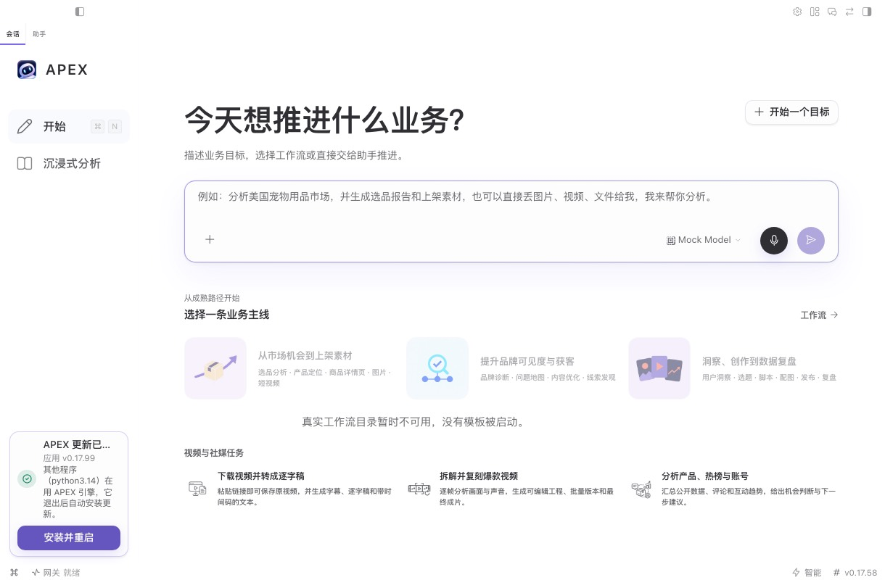
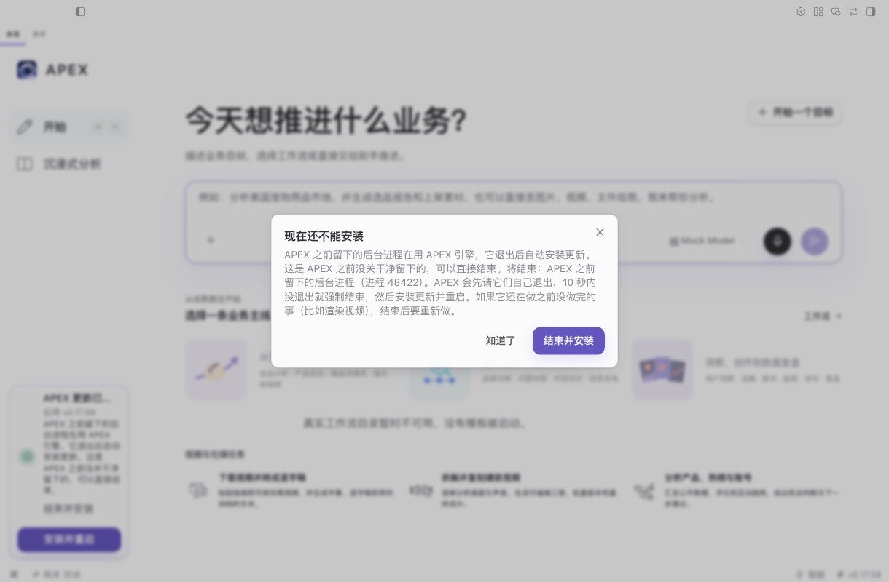
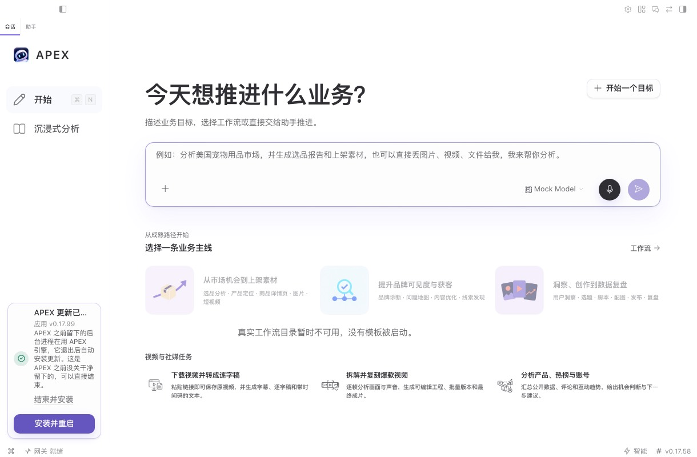
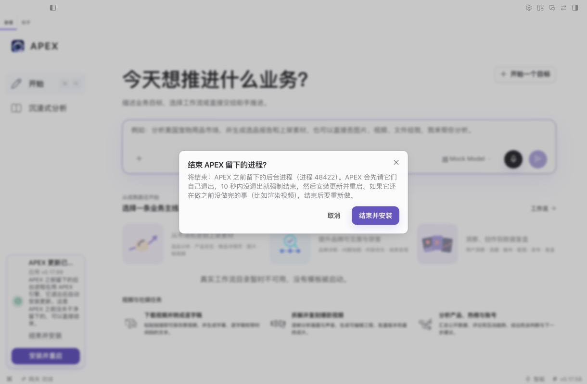
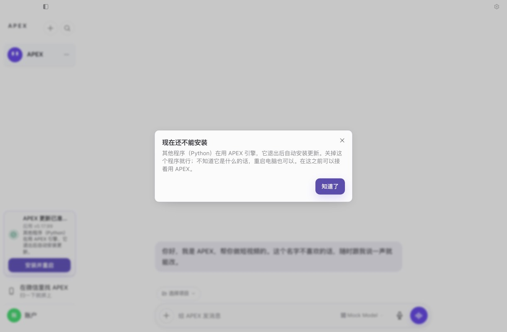

# hc-1117 — 更新被 APEX 留下的进程卡住

PD Sheet1 第 1054 行。PR 正文有根因、出口清单和反向验证表，这里只放 e2e 和截图。

## 怎么测的

dev Electron + 真实引擎 + 假 LLM（`setupMockBackend`），`npm run build` 后跑 Playwright。dev 版没有更新器，所以用本地补丁接了一个假的 `autoUpdater`：`emit('update-downloaded')` 触发，`quitAndInstall` 只记录。其他都是真的：渲染端、IPC、闸门、psutil 扫描、结束脚本。这个补丁不能提交，所以 spec 也没进仓库。

沙箱用真实的打包引擎布局，从本机已安装的引擎克隆：`hermes-agent → versions/<key>`，`venv/bin/python → ../../.runtime/py/cpython-…/bin/python3.14`。孤儿进程用 `hermes-agent/venv/bin/python -c 'time.sleep(600)'` 起，启动器立刻退出，`ppid=1`。这和 10-30 那台 Mac 日志里的形状一样：exe 在 `versions/<key>/.runtime/py/`，argv[0] 走软链接。

## 结果

| 场景 | 干净 main 917672ef | 这个分支 |
|---|---|---|
| 直接孤儿 | 卡片写「其他程序（python3.14）」，没有按钮，确认后没有任何回答，进程还在，没有安装 | 回答 → 关掉 → 卡片上有「结束并安装」→ 确认 → 进程结束（`leftover_child terminated`）→ `verified idle` → `quitAndInstall` 一次 |
| 包一层 shell（`bash -lic "set +m; python … \| cat"`，shell 的 `ppid=1`，python 的父进程是 shell） | 没跑 | 回答里的「结束并安装」→ 结束 → `quitAndInstall` 一次 |
| 系统 Python，孤儿，cwd 在引擎里 | 没跑 | 回答说「其他程序」和「关掉这个程序就行」，不给按钮；进程退出后自动安装，回答自己关 |

## 截图

| | |
|---|---|
| 修复前：确认后的样子，和用户截图一字不差 |  |
| 确认后的回答 |  |
| 关掉回答后的卡片 |  |
| 从卡片结束的确认 |  |
| 其他程序 |  |

## 没验证的

- Windows：只有表驱动测试，真进程测试的 Windows 分支没跑，也没有真机验证。
- 打包产物：这里是 dev 版。候选包要按发版流程再验一次。
- 只换引擎、开机 `keptBack: busy`：只有单测。
