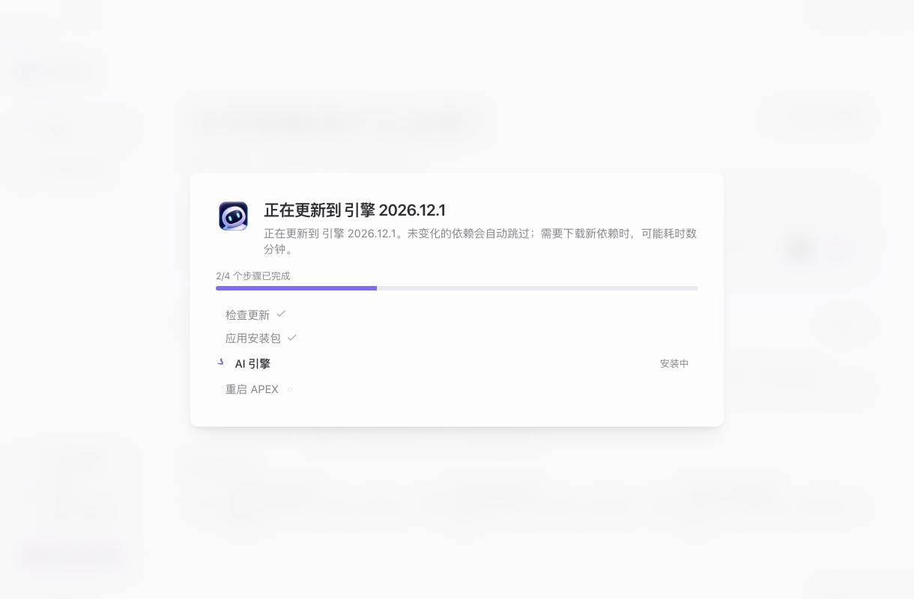
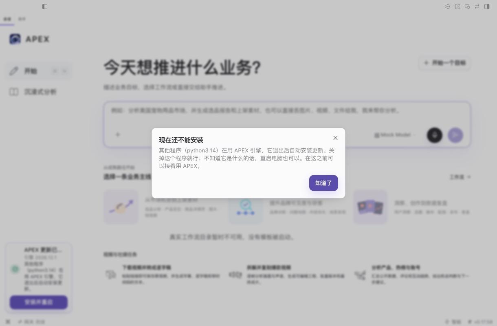

# hc-1118 — 引擎更新在等待时，全屏「正在更新」每 30 秒闪一下

PR 正文有根因、出口清单和反向验证表，这里只放 e2e 和截图。

## 怎么测的

dev Electron + 真实引擎 + 假 LLM（`setupMockBackend`），`npm run build` 后跑 Playwright。渲染端、preload、计划文件和 30 秒定时器都是真的。dev 版没有打包引擎可换，所以把 `hermes:runtime:check-update`、`hermes:runtime:version`、`hermes:runtime:apply-update` 这三个 IPC 换成了假的，假的按 `electron/apex-bundle-install.ts` 的真实顺序发进度：`preflight`、`downloading`、`verifying`，然后才到占用检查。

采样器是页面里的 `MutationObserver`，全屏卡片每提交一次就记一次，只闪一帧也记得到。spec 和本地补丁（关掉 dev 版注册 `apexnodes://`）不能提交，所以没进仓库。

步骤：更新卡片点「安装并重启」，确认后等待对话框出现，再看 3 轮 30 秒重试，然后放行。

假 IPC 有两种形状。线上 Mac 走打包路径（`HERMES_BUNDLE_MODE` 在打包配置里没有设置）：没有进度事件，放行时只回 `reloadRequired`。另一种是 bundle 路径：有进度事件，放行时发 `activating`。

## 结果

| | 修复前（#538 的 head 0bac0f6c） | 这个分支 |
|---|---|---|
| 第一次确认 | 卡片出现 1 次，约 1 秒 | 一样 |
| 3 轮等待重试 | **卡片出现 3 次，每次约 1 秒** | **0 次** |
| 等待对话框 | 被盖住 | 一直可见 |
| 放行（bundle 路径） | 卡片出现 1 次，到换完收起，计划清除 | 一样 |

打包路径只跑了这个分支：3 轮等待重试卡片 0 次，对话框一直可见；放行后卡片在 reload 之前升起，reload 后下一个渲染端读到目标已生效，计划清除，没有卡片残留。

## 截图

| | |
|---|---|
| 修复前：重试时盖住整个界面和等待对话框 |  |
| 修复后：3 轮重试后，对话框还在，没有卡片 |  |
| 修复后：放行后真正开始换引擎 |  |

## 没验证的

- 打包产物和真实占用：这里的引擎 IPC 是假的。真实占用下的判断和答复没有变，hc-1117 的 e2e 测过。候选包要按发版流程再验一次。
- 修复前跑了两次，第一次在第三轮重试后对话框不见了，第二次没有；修复后的一次也没有。原因没查到。那次的现场已经清掉，可能是有人点到了窗口。
