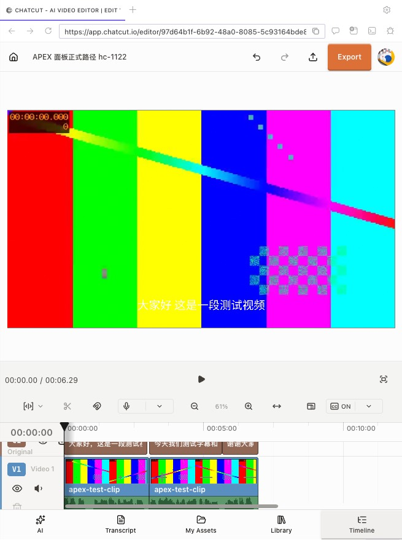
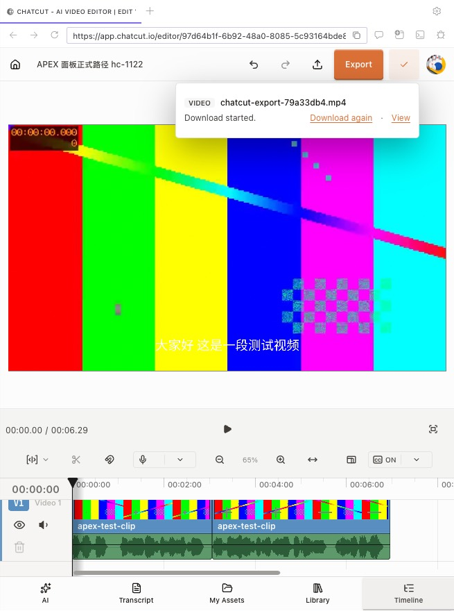
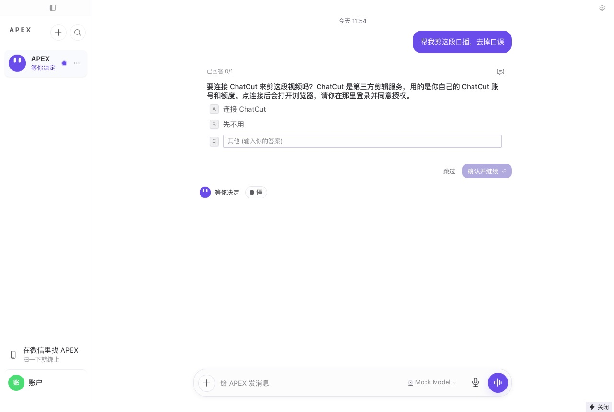
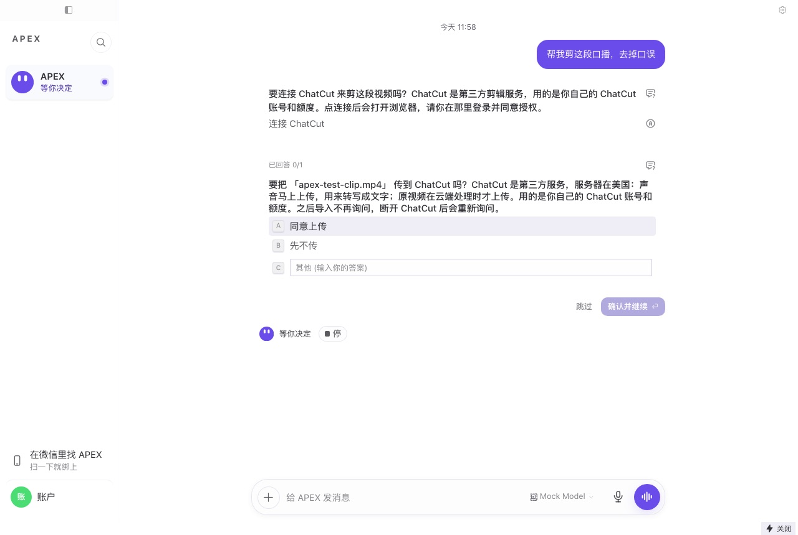
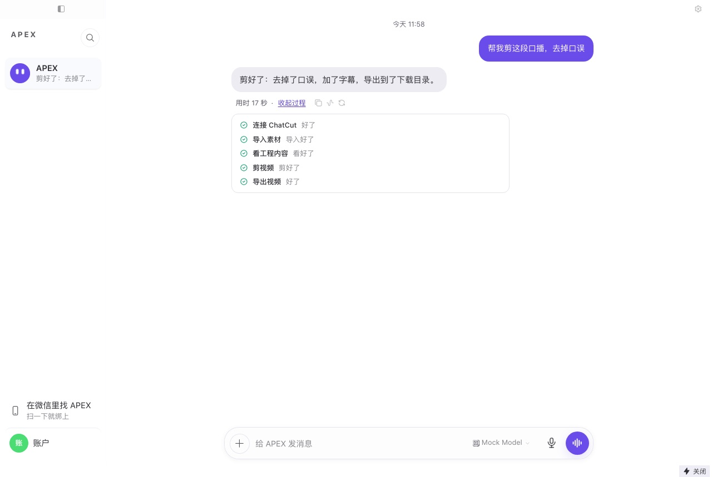
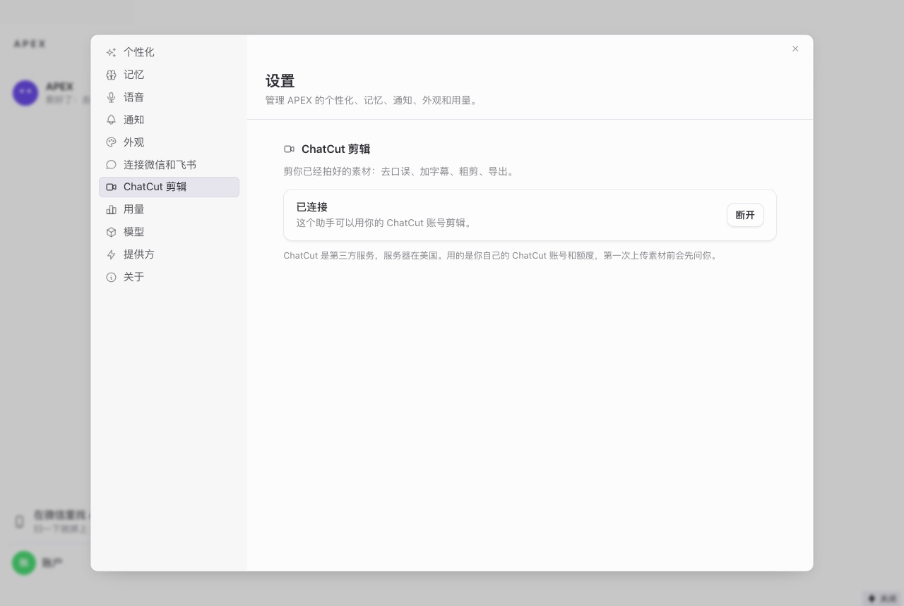
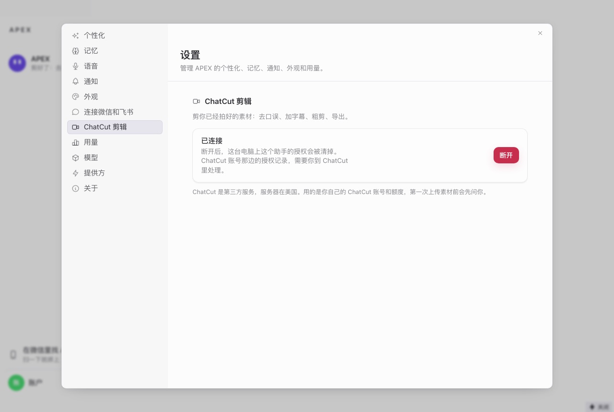
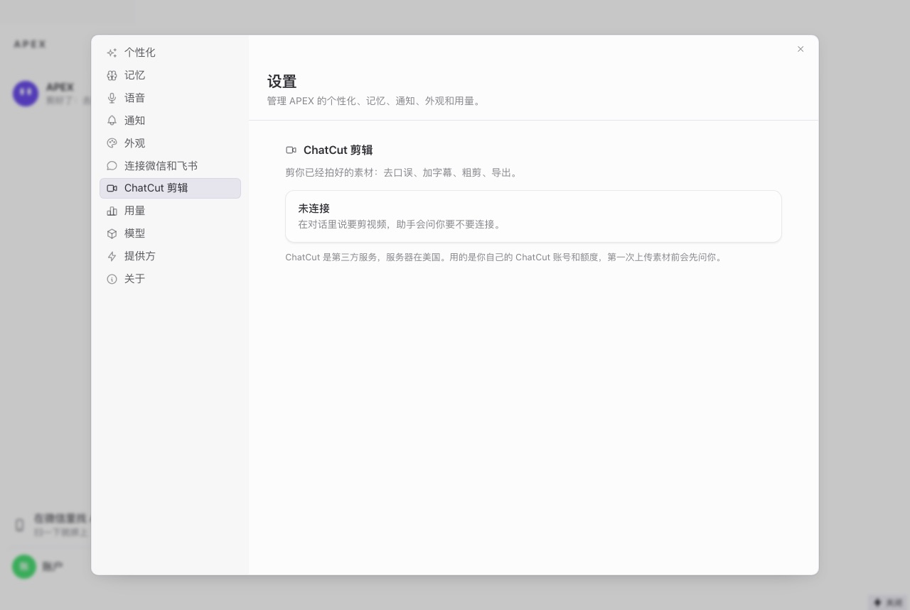

# hc-1122 — 把 ChatCut 接进 APEX Desktop

PD Sheet1 第 1059 行。PR 正文有方案、出口清单和反向验证表，这里只放验收过程和截图。

**现在的连接方式（用户自己的 ChatCut 账号 + 浏览器授权）只供开发和验收**，所以开关不开，这条入口的文案也没有再打磨。

## 怎么测的

全新沙箱的 dev Electron + 仓库里的真实引擎，每次都从首启开始，没有预置 token 或配置。

| 走查 | 模型 | ChatCut | 看什么 |
|---|---|---|---|
| 界面走查 | 脚本模型（通过 `tool_call` 调工具，和真模型一样） | 本地假服务（`tests/apex_overlay/chatcut_fake_service.py`） | 卡片、步骤文案、设置页、断开 |
| 系统 Chrome | 脚本模型，参数全部取自上一步的真实结果 | **真实 ChatCut**，Kael 的免费账号 | 授权、导入、转写、剪辑、字幕、导出 |
| **右侧面板** | 同上，面板是唯一的编辑器 | **真实 ChatCut**，同一账号 | 同上，加面板登录、下载、退出账号清理 |
| 关闭验收 | 脚本模型 | 无 | `APEXNODES_CHATCUT=0`：没有痕迹 |

可行性验证的完整记录在交接笔记 `hc-1122-feasibility.md`。

## 编辑器放进右侧面板：能用

Electron 40.10.2，面板 session 是 `persist:hermes-preview`，GPU 开着（和用户的 APEX 一样）。

| 问题 | 结果 |
|---|---|
| 编辑器能不能跑 | 能。时间轴、播放、字幕、面板尺寸都正常 |
| 导出能不能用 | 能。本地渲染，`~/Downloads/chatcut-export-79a33db4.mp4`，7129695 字节，7.04 秒，字幕烧进了画面，**没有弹保存框** |
| Google 登录 | **不能用。** Google 在面板里拒绝（“This browser or app may not be secure”）。不改 User-Agent 硬闯 |
| 邮箱验证码登录 | 能用，重启后还在 |
| 本机文件服务 | 通。编辑器取本机地址返回 206，没有权限框。`main.ts` 只给默认 session 设了权限 handler，面板的 session 走 Electron 的默认放行 |
| 转写、取画面 | 都能用。取画面（`preview_timeline`）返回图片 |

按产品路径完整走了一遍：`chatcut_connect` 卡片 → 建工程 → 面板打开（上面没有「使用默认浏览器配置」的弹窗）→ `chatcut_import_files` 同意卡 → `edit_item` → 转写 → `read_script`/`apply_script` 剪到 7 秒 → 建字幕并生成 → `submit_export`。

| 剪辑后 | 导出后 | 成片里的一帧 |
|---|---|---|
|  |  |  |

### 踩到的两个假象

- **e2e 夹具默认带 `--disable-gpu`。** 编辑器因此报 `browser_unsupported`，取画面超时，一度看起来面板跑不动。这是测试环境的问题，用户的 APEX 开着 GPU。去掉后全部正常。
- **面板默认没有下载处理。** 导出会弹系统保存框。开关开时，编辑器页面的下载直接存到下载目录，其他页面仍弹框。

## 退出账号时面板里的登录

这一项是真实面板查出来的 bug。第一版按站点调 `clearStorageData`，单测全绿，但在真实面板里清完再重启，**仍然是登录状态**：登录 cookie 在 `.chatcut.io` 上，按站点清存储碰不到。

修复后，在真实 Electron 和真实登录态上跑了真实代码（`scrubChatcutConnections`，编辑器开着）：

| 项 | 清理前 | 清理后 |
|---|---|---|
| 编辑器页面 | 已登录，显示工程列表 | 自动刷新，显示 Sign in |
| `chatcut.io` cookie | 7 个，含 2 个 `__Secure-better-auth.session*` | 只剩页面重新加载写的 3 个匿名统计 cookie，没有登录 cookie |
| 面板目录 | 49M | 21M（主要是 HTTP 缓存） |
| 其他网站的 cookie | 有 | 还在（`accounts.google.com` 等） |

清理后再查：IndexedDB 0 字节，页面里 `indexedDB.databases()` 是空的；工程名、素材名、导出文件名按字节扫描 0 处。这几项在这次清理之前，旧版清理已经跑过一次，所以这里只证明清理后的状态，不是这一次的差值；真正靠新代码才清掉的是登录 cookie 和 HTTP 缓存。

还留着的：工程 UUID 还在 Local Storage 和 Session Storage 的 leveldb 旧日志里，以及 Code Cache。页面读不到（`localStorage` 里已查不到），要等压缩。UUID 不是凭证，没有内容。

这里跑的是函数本身。沙箱没有真 APEX 账号，所以**没有真的点过「退出」**；两个调用点（退出、换账号）由测试钉住。退出后立刻退出 App，异步清理可能没跑完。

## 其他结果

| 项 | 结果 |
|---|---|
| 助手提议连接 | 工具自己弹选择卡，用户不用看到任何技术词 |
| 选「连接」 | 打开系统浏览器，授权后 token 落到这个助手的目录，工具当场可用，不用开新会话 |
| 写 MCP 配置时引擎是否重启 | **没有**。engine PID 全程不变，`desktop.log` 没有重启记录 |
| 第一次导入 | 弹同意卡，说清传到哪里、用谁的额度；同意后写进 `apex/chatcut-upload-consent.json`，之后不再问 |
| 系统 Chrome 上的导入 | 从我们自己的本机服务取文件，5 秒完成，Kael 确认没有弹「访问本地网络」的框 |
| 额度 | 前后都是 5，没有调用任何生成工具（白名单里也没有） |
| 看过程 | 全部是人话（「连接 ChatCut」「导入素材」「剪视频」「处理字幕」「导出视频」），没有 `mcp__chatcut__…` |
| 断开 | 工具、配置、token、同意记录都清掉；engine PID 不变；按字节扫沙箱没有残留 |
| 开关关 | 设置侧栏没有 ChatCut；模型看不到任何 chatcut 工具；config.yaml 没有 chatcut，没有 `mcp-tokens`，`desktop.log` 没有 `APEX_CHATCUT` |
| 技能 | `skill_view chatcut` 按名字能读到（3729 字），索引里按设计看不到，提示词段会点名它 |

## 走查查出的问题（已修）

**第二张卡点不了。** 卡片是工具内部发起的，转录里没有配套的 `clarify` 开始和结束，上传卡落在了已回答的连接卡那一行，选项全灰，单元测试全绿也测不出。现在每张卡自己发开始和结束（`ask_on_card`），守卫是 `test_each_card_gets_its_own_clarify_row_that_opens_and_closes`。

## 截图

| | |
|---|---|
| 助手提议连接 |  |
| 第一次上传前征得同意 |  |
| 看过程 |  |
| 设置：已连接 |  |
| 设置：断开前再问一次 |  |
| 设置：未连接 |  |

截图里的 Mock Model 和「提供方」是因为沙箱走的「使用自己的密钥」；APEX 账号下没有这两项。

## 没验证的

- **真模型按技能走**：验收用的是脚本模型，证明了每个工具和卡片都通，没有证明真模型读技能后的表现。开关打开前要 Kael 用真实账号说一句「帮我剪这段」试一次。
- **打包产物**：这里是 dev 版。候选包要按发版流程再验一次。
- **真实账号点退出**：见上。
- **关着编辑器时的真实报错**：假服务上测过自动打开再重试；真实报错 `No open editor is available for local media import.` 见过，代码不依赖文字内容。
- **Safari 和其他 Chrome 版本**：见 PR 正文「本机文件服务在别的浏览器里」。
- **多助手的界面走查**：克隆配置不算已连接、连接按助手存，是单元测试和引擎按 `HERMES_HOME` 取目录保证的，没有在 `APEXNODES_MULTI_BOT=1` 的界面上走过。
