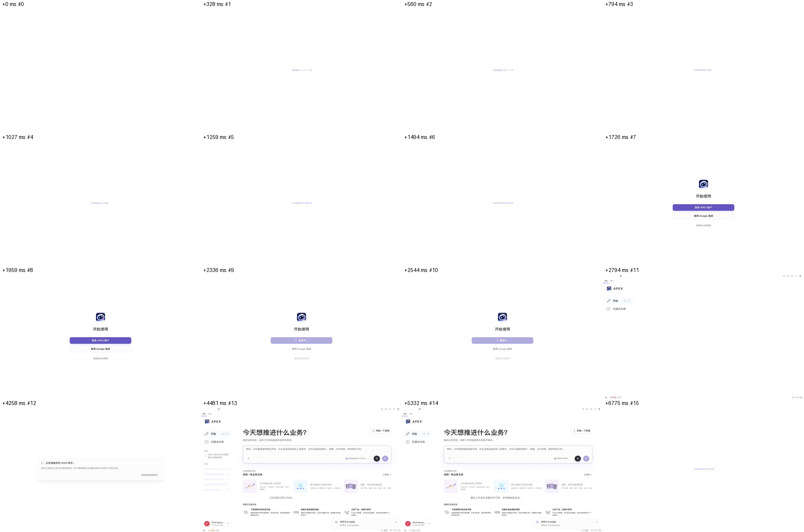
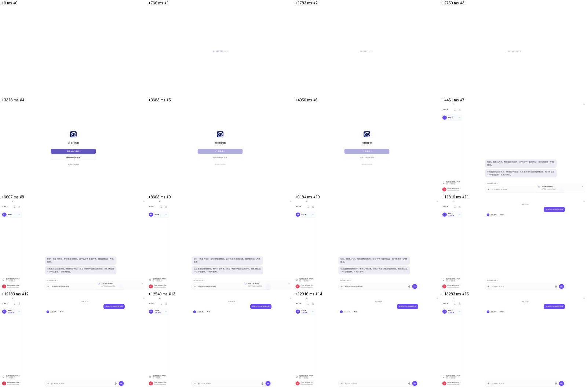

# hc-1127 — 全新安装第一次打开就是产品模式

## 问题

窗口和引擎一起启动（`createWindow` 里调 `startHermes`），都排在第一次拉平台配置之前。没有缓存的第一次启动读到的开关全是空的：登录后是旧工作台，引擎环境变量也没设。配置随后存进缓存，所以退出重开就对了。

配置回来得够快时，窗口有机会读到，界面就是对的，但引擎环境还是错的。所以这个问题和网络有关，本地假服务 0 毫秒回应时看不到旧界面，测试要带上真实耗时。

## 环境

全新沙箱里的 dev Electron，跑这个 PR 构建的 `dist` 和这个 checkout 的真引擎。账号服务、relay、LLM 都是本地假的，没有付费请求。时长那一节里，「真实接口」一行连的是公开的 `GET /api/v1/desktop/client-config`（不需要登录，只读）。

用例在 `e2e/first-launch-product-mode.spec.ts`。`e2e/first-launch-recorder.cjs` 在每个窗口的预加载里记录可见的旧界面文字，在主进程里记录时间点。

没有跑打包产物，也没有用真实账号。

## 修复前后

配置延迟 0.85 秒（`curl` 从这台 Mac 测公开接口的耗时），同一条用例：

| | 干净 main（b881175df2） | 这个 PR |
|---|---|---|
| 登录前 | 登录页 | 登录页 |
| 登录后 | 旧工作台（今天想推进什么业务、沉浸式分析） | 产品模式 |
| `APEX_SINGLE_THREAD_ACTIVE` | 没设 | 1 |
| `APEX_MULTI_BOT_ACTIVE` | 没设 | 1 |
| `APEX_HYPIHUB_ACTIVE` | 没设 | 1 |
| 模型请求里的「APEX 怎么说话」规则 | 没有 | 有 |
| 可见的旧界面帧 | 有 | 0 |
| 退出重开 | 产品模式 | 产品模式 |

修复前：

修复后，从第一帧到第一句回复：

## 各种情况

每种都是全新沙箱实际跑的，「窗口多等」是相对 main。

| 情况 | 窗口多等 | 登录前 | 登录后 | 引擎环境 |
|---|---|---|---|---|
| 平台开、网络正常 | 一次请求的时间 | 登录页 | 产品模式 | 第一次启动就对 |
| 平台关（比如回滚后的新版本） | 一次请求的时间 | 登录页 | 旧工作台，不闪 | 第一次启动就对（都没设） |
| 安装开关 `=0`，平台开 | 一次请求的时间 | 登录页 | 旧工作台 | 没设 |
| 安装开关 `=1`，平台关 | 一次请求的时间 | 登录页 | 产品模式 | 1 |
| 配置请求失败（404），登录时恢复 | 几乎没有 | 登录页 | 产品模式，不闪 | 登录重启后是 1 |
| 离线（端口不通） | 约 0.6 秒（两次重试） | 登录页 | 没走（假账号服务也不通） | 没设 |
| 连接不回话 | 2.5 秒封顶 | 登录页 | 见下一行 | 没设 |
| 配置比上限晚、比登录早 | 2.5 秒封顶 | 登录页，开关在下面翻过去，看不到 | 产品模式，不闪 | 登录重启后是 1 |
| 配置比登录的等待还晚（测试里 4 秒才回） | 2.5 秒封顶 | 登录页，「登录中」多转 2.5 秒 | 先看到旧界面约 1 秒，配置一到就翻成产品模式 | 这次启动没设，下次启动是 1 |
| 已有缓存 | 0 | 登录页 | 按缓存 | 按缓存 |
| 已有缓存、平台发了更高版本 | 0 | 这次按旧版本 | 这次按旧版本 | 下次启动才变（实测第二次启动） |

等待期间屏幕上没有窗口，macOS 只有程序坞图标在跳。窗口本来就要等第一次绘制才显示。

等待期间退出：进程正常退出，没开窗口，没留引擎进程（`SIGTERM`，实测）。

### 平台把开关关掉，哪一次启动生效

- 新安装：第一次启动。配置在窗口前就到了，所以既不会闪，也不用重开。
- 已有缓存的安装：下一次启动，和现在一样。回滚靠更高的版本号，这个规则没动。

## 时长

不经过 Playwright，直接拉起 Electron，从进程创建开始算。每种跑 3 次取中位数，单位是秒。

| 情况 | 窗口显示（main → 这个 PR） | 登录页出现（main → 这个 PR） | 多等 |
|---|---|---|---|
| 真实公开接口（这台 Mac，Node 约 0.13 秒） | 0.60 → 0.73 | 2.34 → 2.44 | +0.10 |
| 配置 0.85 秒才回（`curl` 测同一接口的耗时） | 0.60 → 1.47 | 2.31 → 3.17 | +0.86 |
| 域名解析失败（`.invalid`） | 0.59 → 1.23 | 2.24 → 2.89 | +0.65 |
| 端口不通 | 0.60 → 1.23 | 2.30 → 2.94 | +0.64 |
| 连接不回话（main 不等配置，按 2.30 算） | 0.60 → 3.11 | 2.30 → 4.81 | +2.51 |
| 已有缓存 | 0.60 → 0.59 | 2.25 → 2.24 | 0 |

「窗口多等」只发生在没有缓存的那次启动。打包产物第一次启动还要激活引擎（约 20 秒），这里没有计入。这台 Mac 的网络不代表用户的网络：同一个接口 `curl` 要 0.85 秒，Node 只要 0.13 秒左右，所以两种都列了。

## 开关关闭、开发者模式逐字节不变

- **golden**：第一个提交只有 `src/__identity__/first-launch/store-trace.json`，是在干净 main 上录的。11 种启动，记录首帧读到的值、读完的值、问 main 的次数、写存储的内容。
- **真实应用的 DOM**：全新沙箱、平台关，同一条用例分别跑 main 和这个 PR，保存登录页和登录后的完整 `document.body`，去掉生成的 id、端口、转圈动画帧、轮换的占位文字和定时消失的提示后比较。

| 页面 | main 和这个 PR | 字节数 | sha256 前 16 位 |
|---|---|---|---|
| 平台关 · 登录页 | 相同 | 50974 | `28c138574d061183` |
| 平台关 · 登录后 | 相同 | 80362 | `6b3c32690b35ef3d` |
| 开发者模式 · 平台开 · 登录后 | 相同 | 86305 | `3b77842e3b6d48b4` |

现有的 `__identity__` golden 也都没有改。

## 反向验证

每处都把故障注回去，断言注入点只命中一次，跑完按内容还原并核对 sha256。32 处全部变红。脚本和完整输出不在仓库里，下面是每处第一条变红的测试。

| 注入 | 结果 | 变红条数 | 第一条 |
|---|---|---|---|
| main: the first window no longer waits | RED | 1 | main.ts opens the first window in that order holds createWindow behind the settle, and is the on |
| main: window created before the settle | RED | 1 | main.ts opens the first window in that order holds createWindow behind the settle, and is the on |
| main: a second launch can open a window during the hold | RED | 1 | main.ts opens the first window in that order nothing else can open the window during the hold |
| main: sign-in commits the key without waiting for the config | RED | 1 | main.ts opens the first window in that order sign-in settles before it commits the new key, so t |
| main: sign-in waits only after the key is committed | RED | 1 | main.ts opens the first window in that order sign-in settles before it commits the new key, so t |
| main: the landing config never reaches the environment | RED | 1 | main.ts opens the first window in that order settles this launch into the environment with the s |
| main: sends on another channel than preload listens to | RED | 1 | main.ts opens the first window in that order main and preload use one channel for a late config |
| preload: listens on another channel than main sends on | RED | 1 | main.ts opens the first window in that order main and preload use one channel for a late config |
| sync: the settle returns without waiting | RED | 5 | a launch with nothing cached opens the window after the config landed, with the engine environme |
| sync: no cap on the wait | RED | 3 | a launch with nothing cached waits no longer than the cap on a connection that never answers, an |
| sync: holding flag never set | RED | 1 | a launch with nothing cached opens the window after the config landed, with the engine environme |
| sync: holding flag never cleared | RED | 2 | a launch with nothing cached opens the window after the config landed, with the engine environme |
| sync: switches not settled when the config lands | RED | 5 | a launch with nothing cached opens the window after the config landed, with the engine environme |
| sync: windows not told when the config lands | RED | 4 | a launch with nothing cached opens the window after the config landed, with the engine environme |
| sync: switches settled before the config is stored | RED | 4 | a launch with nothing cached opens the window after the config landed, with the engine environme |
| sync: the boot check asks again in a launch that just fetched | RED | 1 | a launch with nothing cached the first fetch is the boot check: one request, not two |
| sync: sign-in does not wait | RED | 2 | a launch with nothing cached sign-in waits for the config before it goes on, when the launch nev |
| sync: sign-in waits with no cap | RED | 1 | a launch with nothing cached sign-in gives up at the cap too, and a config arriving later still  |
| sync: every launch fetches before its first window | RED | 1 | an install with a config cached: exactly what it did before opens the window without a request o |
| sync: a newer version re-settles a running cached install | RED | 1 | an install with a config cached: exactly what it did before a newer version is stored for the ne |
| sync: an older version lands (rollback rule) | RED | 1 | an install with a config cached: exactly what it did before an older version never lands: a roll |
| sync: stops sending the known version | RED | 1 | an install with a config cached: exactly what it did before the boot check asks with the known v |
| sync: applied version reset when storing | RED | 1 | an install with a config cached: exactly what it did before a newer version is stored for the ne |
| main.tsx: does not follow a late config | RED | 1 | the window main.tsx follows a late config before the shell renders |
| first-launch: a late config skips single-thread | RED | 2 | a config that lands after the window opened reaches all three switches read once per window, and |
| first-launch: a late config skips multi-bot | RED | 1 | a config that lands after the window opened reaches all three switches read once per window, and |
| first-launch: a late config skips relay | RED | 1 | a config that lands after the window opened reaches all three switches read once per window, and |
| single-thread: the once-per-window read keeps the old answer | RED | 1 | a config that lands after the window opened the once-per-window reads answer from the new config |
| multi-bot: a late config leaves the cap | RED | 1 | a config that lands after the window opened reaches all three switches read once per window, and |
| single-thread: stores start on (off path drifts) | RED | 1 | launch-time switch stores (hc-1127 identity) every launch traces as recorded on clean main |
| single-thread: the read stops persisting the hint | RED | 1 | launch-time switch stores (hc-1127 identity) every launch traces as recorded on clean main |
| single-thread: a second read per window | RED | 1 | launch-time switch stores (hc-1127 identity) every launch traces as recorded on clean main |

第一轮有 3 处没变红，都是测试的问题，已补：两个读取总是同时返回（后来这段等待代码删了），多助手上限恰好等于默认值。

e2e 不进 CI，所以另在干净 main 上跑了同一个用例：「平台开」和「退出重开」在 main 上是红的，红在第一次启动的旧界面和没设的环境变量；退出重开之后 main 上是产品模式，环境变量是 1，和问题描述一致。

## 边界

- 没有跑打包产物，也没有用真实账号。
- 第一次启动完全离线、又用自己的密钥（不登录）：这一次是旧界面，下一次联网启动才是产品模式。这次启动里不会再去拉配置。
- 配置比登录的等待还晚：引擎已经用旧环境重启了，所以这次启动界面是产品模式、引擎的规则要等下次启动。没有再重启一次，因为这时用户可能已经开始说话了。
- 比上限晚到、登录前用自己的密钥进入：界面翻成产品模式，引擎环境同样等下次启动。
