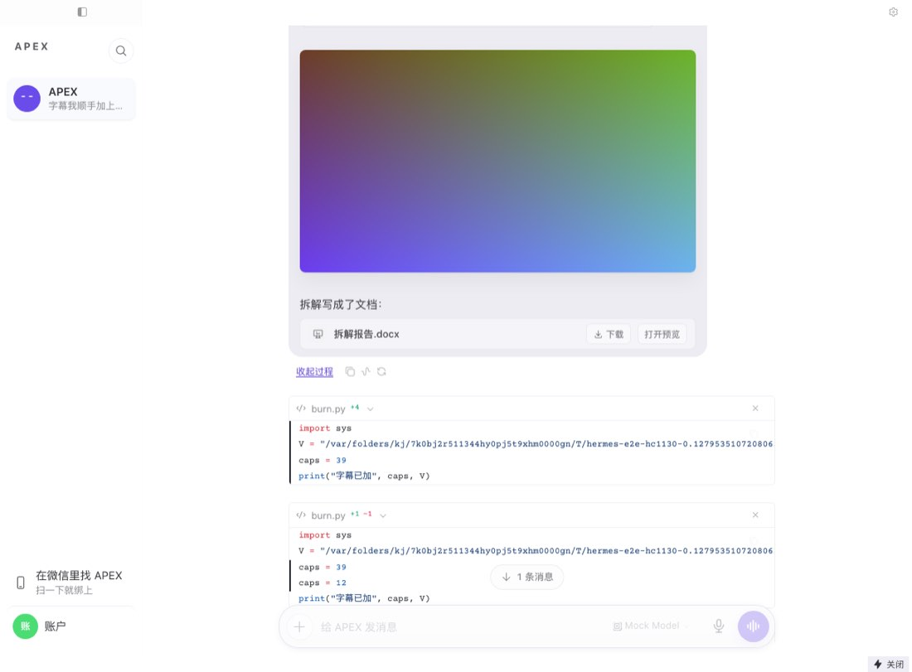
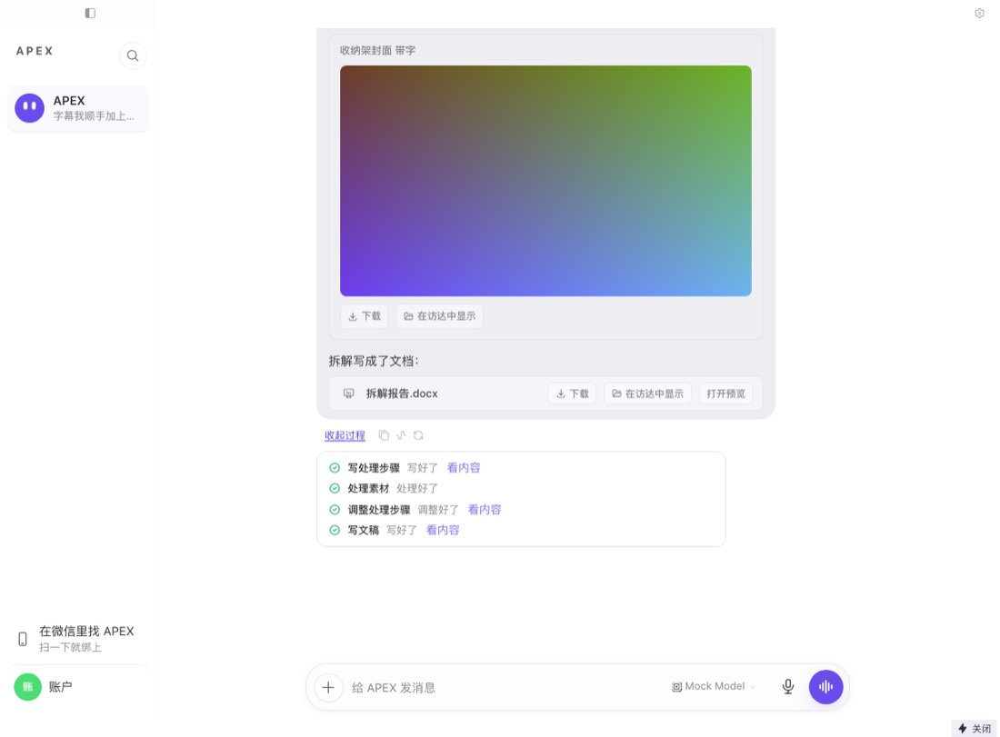
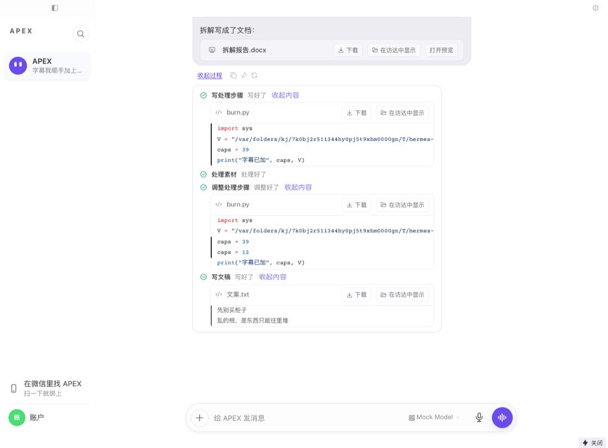

# hc-1130 — 产品模式下拿到结果这一段说人话

## 范围

- 起因：hc-1126 用真实账号走 0.17.69，短视频主线第一次走通，但拿到结果这一段最粗糙：聊天里露 `burn.py` 全文、`+51`、「1 个文件有改动」，视频没有下载按钮，只能点原生播放器的 ⋮（英文菜单），保存框默认文件名是 215 个字符的路径。
- 只动单线产品模式。开发者模式和单线关闭时逐字节不变，golden 在第一个提交里，录在干净 main `b881175df2` 上。
- 审批的文案和范围没动。

## 改后的样子

| 地方 | 改前 | 改后 |
|---|---|---|
| 写文件、改文件 | 聊天里一张卡片，脚本全文和 `+51` 直接摊开 | 收进过程区：「看过程」→ 某一步的「看内容」→ 文件名、改动、下载、在访达中显示 |
| 「1 个文件有改动 / 查看改动」 | 回复末尾一张卡片 | 不再出现 |
| 视频 | 只有播放器，标题是提示词拼的长串加 8 位尾巴 | 短标题、播放器、下载、在访达中显示 |
| 音频 | 同上 | 同上 |
| 图片 | 悬停才有下载，存下来叫 `image.png` | 短标题、图片、下载、在访达中显示；悬停的按钮走同一条路 |
| 文档 | 下载、打开预览，悬停显示完整路径 | 短标题、下载、在访达中显示、打开预览；悬停只显示短标题 |
| 保存框默认文件名 | 整条路径拼起来，215 个字符 | `一条 15 秒的竖屏短视频 分三个镜头.mp4` |
| 原生播放器 ⋮ | Download / Playback speed / Picture in Picture | 没有 Download，其余两项不动 |

### 截图

都来自 dev Electron + 真实引擎 + 假 LLM（见「证据边界」）。

| | 改前（干净 main） | 改后 |
|---|---|---|
| 这一轮的开头 |  |  |
| 原生菜单 |  |  |
| 回复之后 |  |  |
| 点开「看内容」 | 无 |  |
| 审批 |  |  |

改前的审批截图里同一个审批出现了两份（文件卡片下一份，活动行下一份）。改后只有一份，按钮和「命令」都在。

批准之后才写入，这一轮正常结束；用户要的代码也还在回复里：

## 怎么区分「用户要的代码」和「工作过程里的代码」

按来源分，不猜内容：

- **工具调用**（`write_file`、`patch`、`edit_file`、`terminal`、`execute_code`）是工作过程，收进过程区。
- **模型回复的文字**（包括里面的代码块）是回复，一个字不动。这个 PR 只改工具部件走的 `ProcessToolGroupSlot`，文字部件不经过这里。

边界：用户明确让它写代码、模型却用 `write_file` 写进文件时，代码不在聊天主线，要点「看过程」→「看内容」，或者看模型回复里说的文件。渲染层没有可靠办法判断「这个文件是用户要的」，所以不猜。

## 出口清单（硬规则 12）

### 聊天里会露代码、脚本、diff、文件改动、本地路径的出口

| # | 出口 | 代码位置 | 处理 |
|---|---|---|---|
| 1 | `write_file` 卡片 | `process/tool-group-slot.tsx` → `ToolEntry` | **改**：收进过程区 |
| 2 | `patch` 卡片 | 同上 | **改**：收进过程区 |
| 3 | `edit_file` 卡片 | 同上 | **改**：收进过程区 |
| 4 | 「N 个文件有改动 / 查看改动」 | `thread/changed-files-card.tsx` | **改**：产品模式不渲染。这也是右侧「改动」面板在聊天里唯一的入口 |
| 5 | `delegate_task` 卡片的滚动行 | `tool/delegate.tsx` | **改**：这一行转发子任务的命令和路径，产品模式不显示；任务目标和状态留着 |
| 6 | 文档卡片悬停显示的完整路径 | `chat/preview-attachment.tsx` | **改**：只显示短标题 |
| 7 | 媒体卡片标题（提示词长串 + 8 位尾巴） | `markdown-text.tsx` | **改**：短标题 |
| 8 | 卡片加载失败时的英文（`Loading …`、`Open …`） | `markdown-text.tsx` | **改**：产品模式走新卡片，有中英文案 |
| 9 | `terminal` 行 | `processKind` → `activity` | 查过不改：hc-1015 起已收进过程区，测试钉住 |
| 10 | `execute_code`、`read_file`、搜索类 | 同上 | 查过不改：同上 |
| 11 | 从历史恢复的 `tool_call` 外层 | `turn-process.ts` `resolveCall` | 查过不改：本来就不是卡片；内层是写文件时过程区照样能「看内容」 |
| 12 | 审批条的「命令」、浮动审批条、系统通知、「始终允许」对话框 | `tool/approval.tsx`、`server-requests.ts` | **不能改**：这是审批，用户要批准的内容必须看得到 |
| 13 | 模型回复里的代码块、`ArtifactCard` | `markdown-text.tsx` | **不能改**：用户要的代码在这里 |
| 14 | 模型回复文字里写的路径 | `markdown-text.tsx` | 查过不改：是模型的话。用户问「文件在哪」时它就是答案。要少写得改提示词，见「要 Kael 定的事」 |
| 15 | `MEDIA:` 段落和「这一轮还生成了…」那句 | `lib/chat-messages/parts.ts` | 查过不改：已经转成卡片，文字里不留路径（hc-1066 的测试钉住） |
| 16 | `image_generate`、`delegate_task` 失败时的工具行 | `message-parts.tsx` → `ToolFallback` | 查过不改：默认收起，只说失败，点开才有错误详情 |
| 17 | 输入框上方的 Git 状态行（分支、+/-） | `composer/index.tsx` `SHOW_CODING_STATUS_ROW` | 查过不改：常量已关 |
| 18 | 输入框上方的预览行（写了 HTML 时） | `store/preview-status.ts` | 查过不改，但要接住：这一行原来靠文件卡片挂载时登记，卡片收起后改由 `FoldedEditPreviews` 登记。这个「成果」不能丢 |
| 19 | 系统消息（后台任务报告、slash 输出） | `thread/system-message.tsx` | 查过不改：默认收起，不来自这几个工具 |
| 20 | 失败回合、时间线行 | `lib/chat-messages/hydration.ts` | 查过不改：hc-1116 已按产品模式换词 |
| 21 | 右侧面板（文件、改动、终端） | `app/shell/product-fold.ts` | 查过不改：hc-1085 已折叠 |
| 22 | 产物页 | `app/artifacts` | 查过不改：不在聊天里，用户自己打开 |
| 23 | 渲染预算里文件编辑的权重 | `lib/render-weight.ts` | 查过不改：只影响一次挂载多少历史，产品模式会略保守，不影响显示 |

### 媒体结果卡片的操作

| 卡片 | 入口 | 下载 | 在访达中显示 | 默认文件名 |
|---|---|---|---|---|
| 视频 | `MEDIA:`、链接、`` | **新增** | **新增** | 短标题 |
| 音频 | 同上 | **新增** | **新增** | 短标题 |
| 图片 | `MEDIA:`、`` | 原来只有悬停，**新增一行**，悬停也改走这条路 | **新增** | 短标题（原来 `image.png`） |
| `image_generate` 卡片 | 工具卡片 | 同上 | **新增** | 短标题 |
| 文档 | `MEDIA:`、`[x](路径)`、`file://` | 原有 | **新增** | **改成**短标题 |
| 接力交回的文件 | `handoff/cards.tsx` `ReturnedItems` | 随上面自动有 | 自动有 | 短标题 |
| 网络图片 `` | `MarkdownImageContent` | 查过不改：悬停下载 | 没有，不在这台电脑上 | 原样 |
| `MEDIA:https://…mp4` | 新卡片 | 交给浏览器 | 没有，不在这台电脑上 | 由浏览器定 |
| 远程网关上的文件 | 同上 | 走网关下载 | 不显示，文件不在这台电脑上 | 短标题 |
| 开发者模式的卡片 | 旧路径 | 不变（golden 钉住） | 不变 | 不变 |

### 文件还在不在

`shell.showItemInFolder` 碰到不存在的文件什么也不说、什么也不开。卡片比缓存文件活得久，所以 `hermes:fs:reveal` 先查文件（`electron/fs-reveal.ts`），不在就返回 false，卡片提示「这个文件已经不在原来的位置了」。`~/` 路径也展开了。文件树调用同一个通道，它不看返回值，行为不变。

## 保存时的默认文件名

- 下载按钮走 `saveGatewayFile`。原来服务端的 `Content-Disposition` 优先，调用方给的名字被盖掉，所以 `electron/main.ts` 把 `ctx.suggested` 放到最前。它旁边的数据 URL 回退路径本来就是这个顺序。
- 这一改让 `mediaName` 的一个老问题露出来：`new URL('C:\\Users\\a.mp4')` 不报错，取到的是带文件夹的整串。原来被服务端的名字盖着，现在 `decodedMediaName` 先截掉反斜杠。开发者模式下默认文件名和原来一样，都是基本名。

## 文件名是谁定的

| 文件 | 谁定的 | 处理 |
|---|---|---|
| `generate_video` 的成片 | 插件 `plugins/apexnodes-video-tools`：`filename_hint=prompt[:40]` | **改**：取提示词第一句的开头，最多 20 个字（`media_title_hint`） |
| `generate_image` 的图片 | 插件 `plugins/apexnodes-image-tools`：`prompt[:30]` | **改**：同上 |
| 下载的原视频（`不懒退钱_盘点8个…`） | 插件 `apexnodes-douyin-tools`，取视频标题 | 不改：是真实标题；卡片和保存框用短标题 |
| 模型自己命名的文件（`收纳架_15秒_字幕版.mp4`） | 模型 | 不改，这种名字本来就是人话 |

都不是引擎和技能决定的。云端那份插件（apex-nodes `app/runtime_plugins`）不走本地落盘，没有 `filename_hint`，不用配对 PR。插件随引擎包走，要 0.17.70 的引擎钉换到含这个 PR 的提交才生效；渲染层的短标题不依赖它，老文件也会显示短标题。

## 原生播放器菜单：选了「收掉原生下载项」

实测 `--lang=zh-CN`（英文系统的 Mac，干净 main）：菜单变成「下载 / 播放速度 / 画中画」。所以这个菜单跟的是进程启动时的语言，不是界面语言。hc-1126 那台 Mac 系统语言是英文，所以看到英文。

不选「跟随界面语言」的理由：

1. 它要在 `app.ready` 之前定下来，用户在设置里换语言要重启才生效。
2. 它是全进程的：右键菜单、拼写检查、`app.getLocale()` 都跟着变，开发者模式也受影响，违反「开发者模式不变」。
3. 就算做了，原生 Download 还是从流地址拼文件名，长路径问题还在。

选 `controlsList="nodownload"`：有了卡片上的下载按钮，原生下载只剩坏处。倍速和画中画是有用的功能，留着；它们跟系统语言走，中文系统的 Mac 上就是中文。

## 证据边界

**跑过的**

- dev Electron（这个分支和干净 main 各一次）、真实引擎 `hermes serve`、假 LLM。文件真的写了、改了，命令真的跑了，审批是引擎真发的（写 `AGENTS.md` 触发受保护文件审批）。用例：`apps/desktop/e2e/product-result-delivery.spec.ts`。
- 下载走真实的 main 进程和引擎 `/api/fs/download`，保存的字节和源文件一致。
- 保存框收到的默认文件名：`一条 15 秒的竖屏短视频 分三个镜头.webm`。
- 同一条用例在这个分支上连跑 4 次全过；在干净 main 上，出口清单里的 11 个检查都失败（这正是改动的内容）。
- 全新沙箱目录，没碰 `/Applications/APEX.app`，没碰 `~/.apexnodes`。

**没跑过的**

- **没跑打包产物，没用真实账号，没发付费请求。** 发版前 Mac 包验收要走一遍。
- **视频不是 `generate_video` 生成的**：是仓库里的 2 秒小样片（webm）用 `MEDIA:` 交付。插件的命名改动只有单元测试，没有真实生成过。
- **保存框是桩**：`dialog.showSaveDialog` 被替换，记录默认文件名。默认文件名是真的，系统对话框没弹。
- **「在访达中显示」是桩**：`shell.showItemInFolder` 被替换，记录路径。访达没打开。
- 这台 Mac 系统语言是英文，中文系统下的菜单是用 `--lang=zh-CN` 模拟的。

## 反向验证

50 个注入，50 个都让对应的测试变红。每个注入都断言锚点只命中 1 次，跑完用 sha256 确认还原。脚本和逐条结果在协调会话笔记目录的 `hc-1130-inject.py`、`hc-1130-inject-output.json`。

第一轮 R50 没变红：测试写的是 `toContain('文件')`，被同一行的「打开所在文件夹」蒙过去了。改成按文件名本身断言后才变红。

| 编号 | 撤掉什么 | 哪条变红 |
|---|---|---|
| R1 | file edits stay cards in the chat | file edits fold out of the chat leaves no card, diff, count, script or path on the main line |
| R2 | changed-files card stays | file edits fold out of the chat leaves no card, diff, count, script or path on the main line |
| R3 | no contents in the process area | file edits fold out of the chat keeps each edit in the process area, one click behind 「看内容」 |
| R4 | reload loses a write's contents | file edits fold out of the chat still shows what a write put in the file once a reload has lost its diff |
| R5 | failed edits offer contents | file edits fold out of the chat gives a failed edit no contents to open: it changed nothing |
| R6 | HTML preview chip lost | file edits fold out of the chat keeps the preview chip for a page the assistant wrote |
| R7 | diffs dropped from the process area | file edits fold out of the chat keeps each edit in the process area, one click behind 「看内容」 |
| R8 | write_file not an approval tool | an approval is never folded away with its edit hangs off the activity line while a file write waits, buttons and command included |
| R9 | activity line drops the approval | an approval is never folded away with its edit hangs off the activity line while a file write waits, buttons and command included |
| R10 | floating approval never shows | an approval is never folded away with its edit falls back to the floating bar when the write is no longer the running step |
| R11 | reply text folded with the tools | code the model writes in its reply stays in the reply shows a fenced block on the main line, next to folded file edits |
| R12 | no result card | every result card has a way to take the file away a video card: short title, 下载 under that title, 在访达中显示 at the real path |
| R13 | markdown image gets no card | every result card has a way to take the file away an image the model embeds as markdown gets the same card |
| R14 | video keeps native download | every result card has a way to take the file away takes the native download off the player, and leaves the rest of its controls |
| R15 | audio keeps native download | every result card has a way to take the file away takes the native download off the player, and leaves the rest of its controls |
| R16 | save uses the long name | every result card has a way to take the file away a video card: short title, 下载 under that title, 在访达中显示 at the real path |
| R17 | reveal offered on a remote gateway | every result card has a way to take the file away offers no file manager for a file on a remote gateway |
| R18 | a missing file says nothing | every result card has a way to take the file away says so when the file has gone, instead of opening nothing |
| R19 | card has no reveal | every result card has a way to take the file away a video card: short title, 下载 under that title, 在访达中显示 at the real path |
| R20 | card has no download row | every result card has a way to take the file away a video card: short title, 下载 under that title, 在访达中显示 at the real path |
| R21 | document has no reveal | every result card has a way to take the file away a document card keeps 下载 and 预览, saves under its short title and gains the file manager |
| R22 | document saves under the long name | every result card has a way to take the file away a document named after its prompt shows and saves under its short title |
| R23 | document shows its path on hover | every result card has a way to take the file away a document card keeps 下载 and 预览, saves under its short title and gains the file manager |
| R24 | generated image has no row | every result card has a way to take the file away an image_generate card has the row too, and its hover button saves the same way |
| R25 | generated image hover saves the bytes | every result card has a way to take the file away an image_generate card: the button on the image saves the same way |
| R26 | result image hover saves the bytes | every result card has a way to take the file away the button on the image itself saves the file too, under the same title |
| R27 | zoomable image ignores the caller's save | every result card has a way to take the file away the button on the image itself saves the file too, under the same title |
| R28 | delegate ticker stays | a delegated task keeps its goal and drops the ticker, which relays commands and paths |
| R29 | unique tail stays | mediaShortTitle: what a result is called /Users/me/.apexnodes/cache/media/科技空镜 b-roll_9de0fb22.mp4 等 4 条 |
| R30 | nameless files keep their name | mediaShortTitle: what a result is called /Users/me/.apexnodes/cache/media/media_4a2ea035.mp4 等 2 条 |
| R31 | Windows paths keep their folders | mediaShortTitle: what a result is called C:\Users\me\成片\口播_7b1c2d3e.mp4 |
| R32 | titles are not cut | mediaShortTitle: what a result is called /Users/me/.apexnodes/cache/media/一条_15_秒的竖屏短视频_分三个镜头_镜头之间硬切_三个镜头里是同一个人_同一_4a2ea035.mp4 等 2 条 |
| R33 | unsafe characters stay | mediaShortTitle: what a result is called https://cdn.example.com/a/%E5%B0%81%E9%9D%A2%3A%E7%BA%A2.png 等 2 条 |
| R34 | fold ignores the switch | single_thread off, product view: unchanged a finished turn 等 3 条 |
| R35 | changed-files gone with the switch off | single_thread off, product view: unchanged a finished turn 等 3 条 |
| R36 | result card with the switch off | single_thread off, product view: unchanged a finished turn 等 3 条 |
| R37 | markdown image routed with the switch off | single_thread off, product view: unchanged a links turn 等 2 条 |
| R38 | contents toggle with the switch off | single_thread off, product view: unchanged a finished turn with its steps opened |
| R39 | short document name with the switch off | single_thread off, product view: unchanged a finished turn 等 3 条 |
| R40 | image row with the switch off | single_thread off, product view: unchanged a image-card turn 等 2 条 |
| R41 | ticker gone with the switch off | single_thread off, product view: unchanged a delegate turn 等 2 条 |
| R42 | reveal does not check the file | a missing file opens nothing and returns false |
| R43 | reveal does not expand ~ | a ~/ path reaches the file manager expanded |
| R44 | server name beats the short title | finalizeGatewayDownload prompts a save dialog then streams the response |
| R45 | hint is the whole prompt | tests/plugins/test_apexnodes_media_names.py::test_media_title_hint[\u4e00\u6761 15 \u79d2\u7684\u7ad6\u5c4f\u77ed\u89c6\u9891\uff0c\u5206\u4e09\u4e2a\u955c\u5934\uff0c\u955c\u5934\u4e4b\u95f4\u786c\u5207\uff0c\u4e09\u4e2a\u955c\u5934\u91cc\u662f\u540c\u4e00\u4e2a\u4eba-\u4e00\u6761 15 \u79d2\u7684\u7ad6\u5c4f\u77ed\u89c6\u9891] 等 7 条 |
| R46 | video plugin names by the raw prompt | tests/plugins/test_apexnodes_media_names.py::test_both_generators_name_their_files_by_the_hint[apexnodes-video-tools-filename_hint=_gateway.media_title_hint(prompt) or "generated_video"] |
| R47 | image plugin names by the raw prompt | tests/plugins/test_apexnodes_media_names.py::test_both_generators_name_their_files_by_the_hint[apexnodes-image-tools-filename_hint=f"{_gateway.media_title_hint(prompt) or 'image'}_{index}"] |
| R48 | a relative path loses its session | file edits fold out of the chat leaves a relative path to the session that wrote it |
| R49 | a link goes to the save dialog | every result card has a way to take the file away hands a link to the browser: no save dialog, no file manager |
| R50 | a nameless patch has no name | file edits fold out of the chat finds the file inside a reloaded tool_call bridge, and a patch that names no path |

R34–R41 是开关关闭和开发者模式的 golden：把产品模式的判断去掉，golden 就变红。

## 要 Kael 定的事（都按推荐做了，不改也能发）

1. **倍速和画中画留不留。** 现在留着，英文系统的 Mac 上还是英文。全收掉 ⋮ 就没了，也没有倍速了。推荐留。
2. **模型回复文字里的本地路径。** 这张票写明「不改模型和技能」，所以没动。用户问「文件在哪」时它是答案；其他时候可以在提示词里让模型少写。推荐单开一张。
3. **用户要代码、模型写进文件的情况。** 代码只在过程区。推荐先这样，等真实反馈。

## 没改的已知问题

- 开发者模式下原生 Download 的默认文件名还是长路径。开发者模式要求不变，没动。
