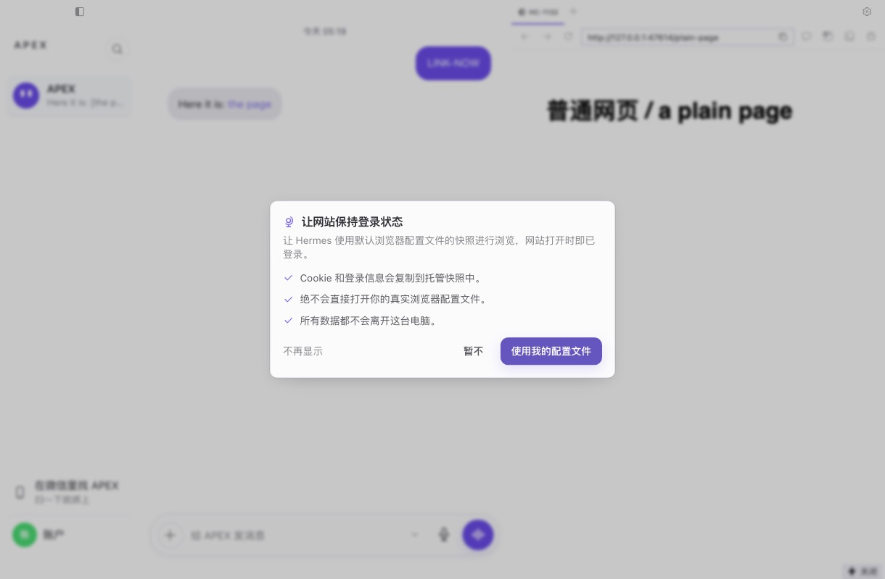
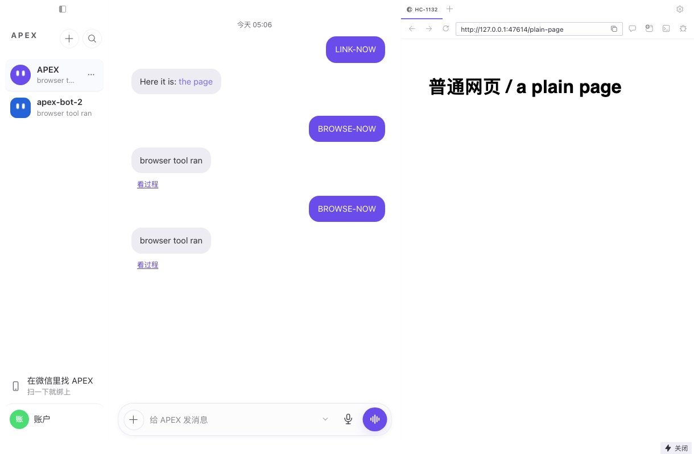
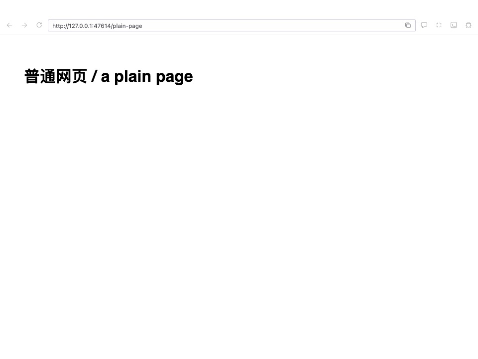
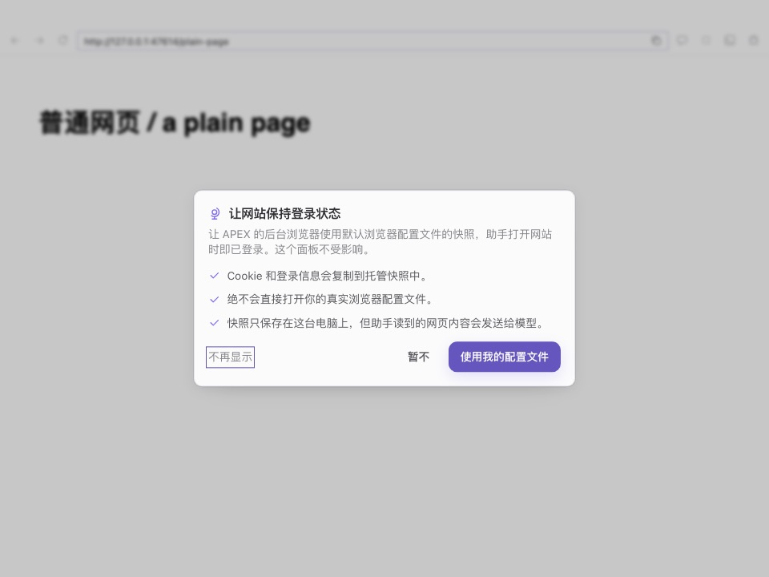
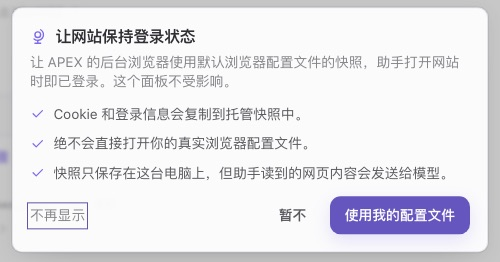
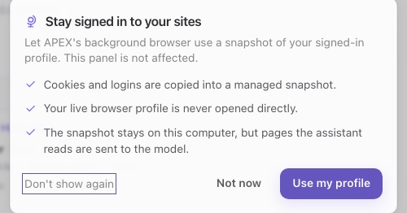

# hc-1132 — 真实配置同意框：产品模式不再弹，已同意的一次性关掉

## 范围

Kael 定了三条：

1. 产品模式不再弹这个框。
2. 已经点过同意的人，在产品模式下一次性关掉，下次用浏览器工具时副本自动删除。
3. 开发者模式留着这个框，改掉 Hermes 和两句不实的话，四种语言。这是「开发者模式逐字节不变」的一次明确例外。

## 为什么

- 框里说「网站打开时即已登录」。但设置只给助手的后台浏览器用，面板 webview 固定用自己的 `persist:hermes-preview`，同意后面板里还是没登录。
- 框里说「所有数据都不会离开这台电脑」。副本确实留在本机，但助手读到的网页内容会作为工具结果发给模型。
- 产品模式把两处开关都折叠了，同意后没有正常的关闭入口。
- Chrome 开着时，每次调用浏览器工具都失败（实测 15.6 秒后报错），不回退到干净浏览器。上游已修（`80f4f989d3`），但还没进 fork。
- 任何网页面板第一次打开就弹，包括助手自己打开的；「暂不」下次启动还会弹。

## 改后的样子

都来自 dev Electron + 真实引擎 + 假 LLM（见「证据边界」）。

| 地方 | 改前（干净 main `12fa0a86e9`） | 改后 |
|---|---|---|
| 产品模式，点聊天里的链接 |  |  |
| 产品模式，弹出窗口 `?win=browser` | 不适用：这条路径在干净 main 上被框挡住 |  |
| 开发者模式，弹出窗口 | 文案是旧的 |  |

| 开发者模式的框（裁剪） | |
|---|---|
| 中文 |  |
| 英文 |  |

## 一次性关闭怎么判断

代码在 `src/app/single-thread/real-profile-reset.ts`，只在主窗口跑，按助手分别算（框写的是当时屏幕上那个助手的配置）。

| 情况 | 做什么 |
|---|---|
| 单线开关关闭 | 完全不跑：不读配置，不写标记，不改设置 |
| 产品模式，这个助手开着 | 关掉一次，记为已处理 |
| 产品模式，这个助手关着 | 不写配置，记为已处理 |
| 开发者模式，这个助手关着 | 不写配置，记为已处理。之后手动打开是用户自己的选择，不会被改回 |
| 开发者模式，这个助手开着 | 不动，不记。之后到了产品模式还开着，就关一次 |
| 读或写失败 | 不记，下次启动再试 |
| 所有助手都处理完 | 记 `complete`，这台机器之后不再读任何东西。之后新建的助手也不看 |
| 连的是远程网关 | 不动：那份配置不属于这台机器 |
| 弹出窗口、HUD、会话窗口、观察窗口、peer 窗口 | 不跑 |

- 标记是本机 localStorage 的 `apex.desktop.real-profile-reset.v1`，一个 `{complete, settled}`。
- 没有任何界面提示。关掉后，真在用这个功能的人下次用助手浏览时是未登录状态。
- 已知的一个边角：开发者模式下故意打开、从没在新版本的产品模式下运行过的人，第一次进产品模式会被关一次。之后再手动打开就不会再动。

### 回滚

这个判断只往「关」的方向改。回滚到旧版本后：

- 已经关掉的不会自动打开。
- 旧版本的框会在产品模式下重新出现，文案也是旧的。
- 标记留在 localStorage。如果用户在旧版本上又点了同意，再升回来时因为标记已完成，不会再关。

### 副本什么时候删

删除由引擎做，这个 PR 没改引擎。默认的 Browser Use 路径（`browser_exec`）和内置路径最后都走到 `_real_profile_cdp`，设置关着时调用 `cleanup_real_profile_snapshots`。实走时用真实的 `browser_exec` 调用验证了两个助手。一直不用浏览器工具，副本就一直留着。配了云端浏览器服务商时不走这里（读代码，APEX 没配）。

## 文案

只改框里的两句。`ar` 没有这个键，读英文。

| 语言 | 句子 | 改前 | 改后 |
|---|---|---|---|
| zh | 正文 | 让 Hermes 使用默认浏览器配置文件的快照进行浏览，网站打开时即已登录。 | 让 APEX 的后台浏览器使用默认浏览器配置文件的快照，助手打开网站时即已登录。这个面板不受影响。 |
| zh | 第三条 | 所有数据都不会离开这台电脑。 | 快照只保存在这台电脑上，但助手读到的网页内容会发送给模型。 |
| en | 正文 | Let Hermes browse with a snapshot of your default browser profile, so sites open already signed in. | Let APEX's background browser use a snapshot of your signed-in profile. This panel is not affected. |
| en | 第三条 | Nothing leaves this computer. | The snapshot stays on this computer, but pages the assistant reads are sent to the model. |
| zh-hant | 正文 | 讓 Hermes 使用預設瀏覽器設定檔的快照進行瀏覽，網站開啟時即已登入。 | 讓 APEX 的背景瀏覽器使用預設瀏覽器設定檔的快照，助手開啟網站時即已登入。這個面板不受影響。 |
| zh-hant | 第三条 | 所有資料都不會離開這台電腦。 | 快照只保存在這台電腦上，但助手讀到的網頁內容會傳送給模型。 |
| ja | 正文 | Hermes が既定ブラウザプロファイルのスナップショットでブラウジングできるようにすると、サイトはログイン済みの状態で開きます。 | APEX のバックグラウンドブラウザが、ログイン済みの既定プロファイルのスナップショットを使います。アシスタントが開くサイトはログイン済みになります。このパネルには影響しません。 |
| ja | 第三条 | データがこのコンピュータの外に出ることはありません。 | スナップショットはこのコンピュータにのみ保存されますが、アシスタントが読んだページの内容はモデルに送信されます。 |

golden 怎么证明「除这几句外逐字节不变」：测试把这两句换回 main 的原文，每句要求恰好命中一次，然后和 main 上录的 golden 逐字节比较。第一个提交只有测试和 golden，录在 `12fa0a86e9` 上，之后没有重录。覆盖五种语言，三种状态（开关关、开发者模式、两者同时）对同一份 golden。

## 出口清单

**框的挂载：1 处。** `preview-pane.tsx`（贴靠标签和 `?win=browser` 共用）。门放在框组件自己里面，所以两个窗口都走同一个门。测试 `the dialog has one mount` 钉住：新的挂载点会让它变红。

**写 `use_real_profile` 的代码：3 处。** 框、「能力」页开关、这次的一次性关闭。测试 `the setting has these writers and no others` 钉住。另外还有两条不经过这些文件的写入路径，都是用户主动操作，不算 bug：开发者模式 设置 › 浏览器 的通用表单字段（走 `saveHermesConfig`），和引擎的 `hermes config set`。

**写着 Hermes 的相关文案：**

| 位置 | 用户看得到吗 | 这次 |
|---|---|---|
| 框正文 `prompt.body`：`en.ts`、`zh.ts`、`zh-hant.ts`、`ja.ts` | 产品模式不再出现；开发者模式看得到 | 改了 |
| 字段说明 `browser.useRealProfile`：`app/settings/constants.ts:623`（en，`ja`、`ar` 也读它）、`zh-hant.ts:759` | 只在开发者模式 设置 › 浏览器 | **没改**：不在这次例外的范围内。`zh.ts:879` 已经是 APEX |
| `hermes_cli/browser_connect.py` 的三条报错（Hermes does not fall back / Hermes can close it / let Hermes offer） | 给模型的，可能被转述；只有设置开着才会出现 | 没改 |
| `tools/browser_tool_real_profile.py:176`（`hermes browser close-profile`）、`:289`（restart Hermes） | 同上 | 没改 |
| `agent/file_safety.py:359-360` | 给模型的，助手试图读副本目录时才出现 | 没改 |
| `tools/browser_use_cli.py:602-603`（不含 Hermes，但指向产品模式没有的 Settings → Browser） | 给模型的，只有 `local=true` 且设置关着时 | 没改 |
| 存储键 `hermes.desktop.real-profile-prompt-dismissed`、标记文件 `.hermes-snapshot-complete`、`~/.hermes/browser-profile`、CLI 帮助、代码注释 | 看不到 | 没改 |

**查过、不含 Hermes、也没改的：** `label`、`description`、`enabledTitle`、`enabledMessage`、`disabledTitle`、`disabledMessage`、`failedSave`、`prompt.title`、`prompt.bulletSnapshot`、`prompt.bulletLiveProfile`、`prompt.dontShowAgain`、`prompt.notNow`、`prompt.enable`。`toggle-*.html` golden 钉住「能力」页开关的文案没变。

## 反向验证

脚本放在协调会话的共享笔记（`hc-1132-inject.py`、`hc-1132-inject-output.json`）。每行注入都先断言锚点恰好命中一次，改完跑三个测试文件，用 sha256 确认还原。42 行全部变红。第一轮 R21 是绿的：原测试的切换发生在扫描读模式之前，碰不到丢触发那条路径。补了一条切换发生在两个助手之间的测试后变红。

| 撤掉或改坏什么 | 文件 | 变红 | 代表性的红测试 |
|---|---|---|---|
| G1 product mode offers again | `real-profile-consent-dialog.tsx` | 8 | hc-1132 product mode offers nothing in en, and reads nothing to decide |
| G2 the offer is gone everywhere | `real-profile-consent-dialog.tsx` | 31 | with the switch off the dialog in en |
| G3 the gate reads the switch only, so developer mode loses the offer | `real-profile-consent-dialog.tsx` | 13 | with developer mode the dialog in en |
| C1 zh body names Hermes again | `zh.ts` | 4 | with the switch off the dialog in zh |
| C2 zh line promises nothing leaves | `zh.ts` | 4 | with the switch off the dialog in zh |
| C3 en body names Hermes again | `en.ts` | 8 | with the switch off the dialog in en |
| C4 en line promises nothing leaves | `en.ts` | 8 | with the switch off the dialog in en |
| C5 zh-hant body names Hermes again | `zh-hant.ts` | 4 | with the switch off the dialog in zh-hant |
| C6 zh-hant line promises nothing leaves | `zh-hant.ts` | 4 | with the switch off the dialog in zh-hant |
| C7 ja body names Hermes again | `ja.ts` | 4 | with the switch off the dialog in ja |
| C8 ja line promises nothing leaves | `ja.ts` | 4 | with the switch off the dialog in ja |
| I1 another zh line of the dialog moves | `zh.ts` | 3 | with the switch off the dialog in zh |
| I2 another en line of the dialog moves | `en.ts` | 6 | with the switch off the dialog in en |
| I3 the dialog layout moves | `real-profile-consent-dialog.tsx` | 15 | with the switch off the dialog in en |
| I4 the Capabilities toggle copy moves | `zh.ts` | 3 | with the switch off the Capabilities toggle in zh |
| I5 accepting writes more than the one key | `real-profile-consent-dialog.tsx` | 4 | with the switch off accepting writes the same one key |
| R1 developer mode is switched off too | `real-profile-reset.ts` | 5 | someone who said yes to the old dialog waits in developer mode, then goes off once on reaching product mode |
| R2 runs with the single-thread switch off | `real-profile-reset.ts` | 4 | someone who said yes to the old dialog also waits when the switch comes on while in developer mode |
| R3 keeps scanning after it finished | `real-profile-reset.ts` | 5 | someone who said yes to the old dialog goes off once in product mode and never again |
| R4 a settled profile is read again | `real-profile-reset.ts` | 2 | turning it on by hand is not undone on one assistant while another still waits |
| R5 an off profile is not settled, so a later "on" is switched back | `real-profile-reset.ts` | 3 | turning it on by hand is not undone when it was off at the first look in developer mode |
| R6 a failed read or write counts as done | `real-profile-reset.ts` | 2 | failures settle nothing a refused write is tried again next launch, once |
| R7 the ledger says complete while someone still waits | `real-profile-reset.ts` | 6 | someone who said yes to the old dialog waits in developer mode, then goes off once on reaching product mode |
| R8 the default profile is addressed by name | `real-profile-reset.ts` | 2 | someone who said yes to the old dialog goes off once in product mode and never again |
| R9 every profile goes to the primary | `real-profile-reset.ts` | 4 | turning it on by hand is not undone on one assistant while another still waits |
| R10 the write turns it on | `real-profile-reset.ts` | 15 | someone who said yes to the old dialog goes off once in product mode and never again |
| R11 reads with defaults merged | `real-profile-reset.ts` | 2 | every assistant reads each profile through its own scope and writes only the one that is on |
| R12 no refresh of the settings pages | `real-profile-reset.ts` | 1 | someone who said yes to the old dialog refreshes what the settings pages show |
| R13 an empty list is recorded as finished | `real-profile-reset.ts` | 1 | failures settle nothing an empty list records nothing |
| R14 a damaged ledger reads as complete | `real-profile-reset.ts` | 1 | failures settle nothing a damaged ledger reads as none: {"complete":"yes","settled":"default"} |
| R15 does not wait for the gateway | `real-profile-reset.ts` | 1 | when it runs waits for the gateway |
| R16 a remote gateway is switched off | `real-profile-reset.ts` | 1 | when it runs leaves a remote gateway alone |
| R17 runs in a pop-out or HUD | `real-profile-reset.ts` | 1 | when it runs leaves it to the primary window: auxiliary |
| R18 runs in a peer window | `real-profile-reset.ts` | 1 | when it runs leaves it to the primary window: peer |
| R19 runs in a watch window | `real-profile-reset.ts` | 1 | when it runs leaves it to the primary window: watch |
| R20 scans run over each other | `real-profile-reset.ts` | 4 | the switch off takes effect the moment product mode really starts |
| R21 a trigger during a scan is dropped | `real-profile-reset.ts` | 1 | when it runs a switch to product mode after a profile was already passed over goes back for it |
| R22 a mode change is not listened to | `real-profile-reset.ts` | 3 | someone who said yes to the old dialog waits in developer mode, then goes off once on reaching product mode |
| R23 the switch is not listened to | `real-profile-reset.ts` | 1 | someone who said yes to the old dialog also waits when the switch comes on while in developer mode |
| R24 the gateway is not listened to | `real-profile-reset.ts` | 2 | failures settle nothing a failed list records nothing and is tried again when the gateway comes back |
| R25 the first look at launch is skipped | `real-profile-reset.ts` | 16 | someone who said yes to the old dialog goes off once in product mode and never again |
| R26 the shell never starts it | `controller.tsx` | 1 | hc-1132 the app root starts the one-time reset at load |

## 实走记录

dev Electron，全新沙箱，`HOME` 和 `HERMES_HOME` 都指向沙箱，真实 `hermes serve`，假 LLM，「使用自己的密钥」。

**A. 单线开、多助手开，默认助手和 `apex-bot-2` 都预置 `use_real_profile: true` 和一份假副本**

| 步骤 | 结果 |
|---|---|
| 启动 | 引擎就绪后两份 `config.yaml` 都变成 `false`（`?profile=` 走通），标记 `{"complete":true,"settled":["default","apex-bot-2"]}`，假副本还在 |
| 点聊天里的链接 | 面板打开，webview 的 partition 是 `persist:hermes-preview`，`[role=dialog]` 0 个 |
| 弹出到 `?win=browser` | 另一个 renderer，单线提示为 true，`[role=dialog]` 0 个 |
| 默认助手上跑一次真实的 `browser_exec` | 默认助手的 `browser-profile/` 被删，`apex-bot-2` 的还在 |
| `apex-bot-2` 上跑一次 | 它的也被删了 |
| 切开发者模式 | 主窗口和弹出窗口都出现新文案的框；英文界面也是新文案 |
| 开发者模式点「使用我的配置文件」 | 写入屏幕上那个助手的配置，默认助手不变 |
| 回产品模式并重启 | 手动打开的值没被改回，标记没变，恢复的面板没弹框 |

**B. 单线关（`APEXNODES_SINGLE_THREAD=0`），同样预置开着**

输入框出现后再等 12 秒：两份配置都还是 `true`，没有标记。

**C. 对照：干净 main `12fa0a86e9`，产品模式，同样的点击**

弹出旧文案的框（「让 Hermes …」「所有数据都不会离开这台电脑」）。说明 A 里的「不弹」不是操作路径碰不到它。

## 证据边界

- dev Electron，不是打包产物；只在 Mac 上跑过。Windows 没跑。
- 「使用自己的密钥」，没有用真实 APEX 账户。真实账户下请求会多带一个 `managedOwner` 字段（`capabilityScoped` 加的），这条没有实走。
- `agent-browser` 换成了占位脚本，`AGENT_BROWSER_EXECUTABLE_PATH` 指向假文件，所以**没有启动真浏览器**。副本删除是真实 `browser_exec` 分发到引擎、走到设置关闭的清理这一段；清理之后的启动在这个环境里按预期失败。
- 沙箱里的副本是假文件。没有在设置开着时调用过浏览器工具，也没有读过这台 Mac 真实的浏览器配置。
- 第一次安装、平台开关还没读到时（hc-1127 那段不超过 2.5 秒的窗口），如果恰好打开了网页面板，框可能短暂出现，开关读到后自动消失。没有复现。
- 多助手实走只有两个助手；更多助手和各种失败路径靠单元测试。
- 「开发者模式下开着，之后才进入产品模式」只有单元测试，没有实走。

## 和 #544 的关系

`hc-1122`（#544）改了同一个函数的签名行。试合并 #544 head `a7947a5e41`：一处冲突，解决方式是保留这个 PR 的门，把 `url` 传进 `RealProfileConsentOffer`：

```tsx
function RealProfileConsentOffer({ tabId, url }: RealProfileConsentDialogProps) {
```

解决后跑 `identity`、`real-profile-consent`、`chatcut` 三组：47 个文件、685 条，0 失败（6 条跳过），其中 identity 43 个文件。

## 测试结果

- 三个守卫文件 86 条通过；`CI=true TZ=UTC` 和 Node 26（CI 同款，`localStorage` 是内存版）都通过，golden 没有变化。
- 桌面端全量 vitest：16886 条，16852 通过，31 跳过，3 失败。失败的 3 条都在 `runtime-gateway-retirement`，干净 main 上同样失败，是本机环境问题。
- `npm run check:lint` 通过（0 error）；`python scripts/check --only health` 通过。
